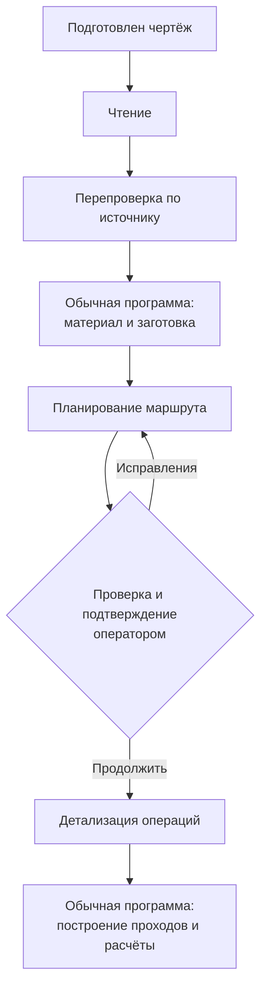

# Агентский сервис в подготовке производства

## Что здесь называется агентом

В системе «Подготовка производства» агент — это модельная роль с определённой задачей, входными данными и ожидаемым результатом. Одна роль читает чертёж, другая перепроверяет прочитанное, третья предлагает маршрут, четвёртая раскрывает содержание операций. Их работа объединена центральной службой, которая управляет задачей и сохраняет результаты.

Центральная служба ведёт заказ как одну задачу, а роли выполняют отдельные этапы её проработки. Каждая получает подготовленный контекст и возвращает ответ в установленной форме. Центральная служба проверяет этот ответ, связывает его с текущими данными и решает, допустим ли следующий шаг.

Для разных ролей могут использоваться настроенные модельные профили. Название роли само по себе не означает отдельную программу, отдельный сервер или обязательно другую модель. Для понимания процесса важны назначение и результат каждого этапа.

## Как распределена ответственность

Модель полезна там, где нужно прочитать неоднородный источник и связать инженерный смысл: отличить размер от примечания, найти требования, предложить последовательность обработки или описать технологическую цель. Обычная программа нужна там, где требуется однозначное применение условий и формул: проверить единицы, построить слои, вычислить время, исключить повторное начисление наладки.

Оператор остаётся участником процесса. Он задаёт условия заказа, проверяет спорные факты и подтверждает переход от предварительной карты к детализации. Модель не должна считать открытие документа, сохранение исправления или просмотр рекомендации согласием на все дальнейшие действия.

| Участник | Его результат |
| --- | --- |
| Роль чтения | Структурированное содержание чертежа и отмеченные неизвестные |
| Роль перепроверки | Проверка первого чтения по тому же источнику и допустимые исправления |
| Роль планирования | Предварительная последовательность операций с ограничениями |
| Роль детализации | Состав работ, установки, цели обработки и основания режимов |
| Центральная служба и расчётные программы | Проверенные данные, проходы, численные показатели, сохранение и стоимость |
| Оператор | Исправления, решения по заготовке и подтверждение актуального основания |

Схема показывает порядок ролей, а не перечень самостоятельных микросервисов. Исправление исходных данных может потребовать вернуться к более раннему основанию, чем показанный возврат к карте.

## Чтение чертежа

### Когда запускается и что получает

Чтение начинается после загрузки и подготовки источника. Система сохраняет оригинал и готовит изображение, которое можно передать модели. Для исходного документа с доступными дополнительными сведениями они также могут входить в контекст. Обычная картинка сама по себе не получает независимый текстовый слой только потому, что её прочитала модель.

Роль получает источник и инструкцию на извлечение данных. Её задача — описать то, что можно установить из чертежа, а не заполнить все поля любой ценой. Например, неизвестная глубина отверстия должна остаться неизвестной, даже если диаметр прочитан уверенно.

### Что возвращает

Результат включает реквизиты детали, материал, размеры, требования, признаки исходной заготовки и сведения, определяющие применимость дальнейшего пути. Отдельно должны сохраняться недостаточность и противоречия.

Размер с отклонением важно прочитать целиком. Номинал, верхнее и нижнее отклонения несут разный смысл; знак отклонения нельзя потерять ради удобного положительного числа. Аналогично назначение заготовки на чертеже не следует сразу заменять рекомендацией, которую система ещё только рассчитает.

### Как результат используется дальше

Первое чтение сохраняется и становится входом перепроверки. После допустимых исправлений оно также служит основанием для справочного поиска, определения размерной потребности и предварительного маршрута. Система ещё не располагает подтверждённой технологией только на основании прочитанного текста.

## Перепроверка чтения

### Когда запускается и что получает

Эта роль вызывается после сохранения первого чтения. Она получает тот же источник вместе с уже извлечёнными данными. Такое устройство позволяет сопоставлять конкретное предположение с чертежом: проверить знак, единицу, привязку размера или пропущенное требование.

Перепроверка является повторным модельным рассмотрением. Она не равна независимому измерению детали и не гарантирует правильность символа, который невозможно различить в исходном качестве.

### Что возвращает и как применяются правки

Роль формирует результат проверки и предлагаемые изменения. Обычная программа проверяет допустимость применения этих изменений, обновляет чтение и сохраняет, что изменилось. Если новое толкование не имеет достаточного основания или остаётся конфликт, проблема должна быть видимой.

Для оператора важен смысл исправления. Например, замена пропущенного минусового отклонения меняет гарантированную потребность в заготовке. Поэтому исправленный текст может повлиять на подбор и маршрут, а не только на красивое отображение паспорта.

### Что передаётся на следующий этап

Дальнейшие шаги получают актуальное чтение, а не произвольную смесь старых и новых величин. Справочные свойства и подбор заготовки дополняют это основание. Если вспомогательный сервис не ответил, полезное чтение не уничтожается; зависимое значение остаётся неопределённым.

## Планирование маршрута

### Условия запуска

Планирование использует текущее чтение, материал, сведения о заготовке и известные ограничения. Если текущая область признана неподдержанной, система не должна строить видимость законченного маршрута через неподходящий основной путь.

Между чтением и планированием работают обычные справочные и расчётные механизмы. Они могут найти свойства материала и рассчитать рекомендацию по заготовке. Эти действия не являются дополнительными языковыми агентами.

### Задача роли

Планировщик предлагает предварительную последовательность операций: какие основные работы необходимы и в каком порядке их предполагается выполнять. Он опирается на геометрию и требования детали, исходную форму материала и доступный контекст оборудования.

Предварительная карта должна помогать человеку проверить логику изготовления. Она не означает, что для каждой строки уже рассчитаны проходы, время и деньги. Операция может быть понятна по назначению, но ещё не иметь достаточной глубины, числа повторов или нормы вспомогательного времени.

### Результат и его дальнейшее использование

Предварительный маршрут сохраняется и предъявляется оператору. Оператор проверяет чтение и карту совместно: неверная заготовка или потерянное требование могут сделать внешне правдоподобную последовательность неприменимой.

Если рассчитана альтернатива назначенной заготовке, решение по ней принимается отдельно. Рекомендация не должна незаметно стать исходным фактом. После существенной правки данные и карта должны снова соответствовать друг другу.

## Подтверждение перед детализацией

Подтверждение фиксирует, что оператор проверил именно текущие исходные данные и предварительную карту, а также принял известные ограничения. Детализация получает это принятое основание. Она не должна продолжаться по старой карте после того, как оператор изменил влияющий на неё размер или количество.

Не каждое изменение требует одинакового объёма повторной работы. Новая ставка станка влияет на деньги; новая рабочая подача — на техническое время; изменение геометрии может затронуть заготовку, цели обработки и последовательность проходов. Центральная служба должна проверять зависимости, а не считать любую сохранённую карту бессрочно действующей.

Если требуется пересмотр, полезные результаты можно сохранить как историю. Но старый результат нельзя выдавать за ответ на новые условия. Это особенно важно при длительном модельном вызове: его завершение не даёт права заменить более новое решение пользователя.

## Детализация операций

### Что получает роль

Детализация запускается после допустимого подтверждения. Ей передаются принятая карта, актуальные данные детали, сведения о материале и заготовке, ограничения и доступный контекст оборудования. Её область — операции этой карты.

Одна роль прорабатывает технологическое содержание. Система не создаёт по языковому агенту на каждый радиальный слой или на формулу силы резания.

### Что должна определить

Роль раскрывает состав работ внутри операции, установки, оснащение, контроль, технологические цели и основания режимов. Цель должна быть связана с нужным элементом или размером детали: недостаточно сказать «обработать поверхность», если невозможно установить, какую поверхность и до какого состояния.

Неустановленные цели и неподдержанные решения сохраняются отдельно. Если для отверстия неизвестна глубина, детализация не должна превращать предполагаемый ход в подтверждённый размер. Если процесс пока не охвачен численным методом, его существование остаётся в составе работ и ограничениях.

В новом рабочем формате модель не выдаёт готовую смету, собственные численные минуты и ручной список физических проходов. Это ограничивает смешение технологического замысла с арифметикой. Режимные основания тоже сохраняют происхождение: предложенное значение не становится производственно подтверждённой нормой только потому, что ответ принят программой.

### Что происходит после ответа

Обычная программа связывает цели с принятыми размерами, проверяет применимость и разворачивает поддержанные работы в проходы. Например, она делит требуемый съём на допустимые слои и ограничивает последний слой оставшимся размером. Для канавки отдельно сохраняется новая снимаемая ширина, даже если последний врез перекрывает предыдущий.

Конкретные задания передаются численному сервису. Он вычисляет показатели своего метода: время движения, объём нового материала, производительность и доступные нагрузки. Число событий партии также может рассчитываться отдельно от минут. Центральная служба проверяет соответствие ответа заданию и сохраняет известные результаты и ограничения.

Обычная детализация заканчивается результатами операций. Отдельный автоматический прогноз ещё не покрытых работ вызывается своим оценочным действием и использует явные допущения. Он не является незаметным обязательным продолжением каждого ответа агента.

## Где заканчивается работа модели

Языковая роль не выбирает коммерческую ставку из ожидаемого итога и не подгоняет время под желаемую цену. Денежный расчёт оператор запускает отдельно по сохранённым результатам и текущим ставкам станков. Изменение стоимости часа не требует заново читать чертёж.

При расчёте времени программа различает работу на одну деталь и общую работу партии. При расчёте денег она учитывает общую наладку один раз и не начисляет повторно услугу, уже включённую в другую строку. Надбавка применяется однократно к обработке, отдельно от материала и его зачёта.

Мощность и энергия относятся к поддержанной расчётной модели. Их наличие не создаёт автоматически денежное начисление за электричество. Так же наличие массы ещё не означает, что установлено, какая масса оплачивается и по какой цене.

## Как сохраняются ошибки, неизвестность и прерывания

Для каждой роли сохраняются её входное основание и полученный результат. Поэтому можно понять, что было известно при построении карты и какие сведения появились позже. История полезна для разбора решения, но сама не заменяет актуальный расчёт.

Если ответ не проходит проверку установленной формы или противоречит условиям применения, его нельзя молча использовать дальше как корректный. Если численному расчёту не хватает режима или геометрии, соответствующее время остаётся неизвестным. Система может сохранить известную часть и показать непокрытые работы.

После отмены или прерывания достигнутые результаты не должны автоматически считаться законченными. Продолжение опирается на сохранённое состояние и проверку актуальности. Прерванная задача не означает самостоятельный новый запуск всех моделей без решения о продолжении.

Слово «неизвестно» здесь имеет предметный смысл. Оно может означать нечитаемый размер, отсутствующую справочную запись, неподдержанную геометрию, непокрытое движение или недоступную цену. Замена всех таких состояний нулём скрыла бы причину и создала бы ложную полноту.

## Пример работы ролей

Пусть оператор загрузил чертёж втулки. Чтение извлекает наружные размеры, материал и требования к отверстию. Перепроверка обнаруживает, что глубина одного элемента не установлена однозначно. Этот вопрос сохраняется, а известные размеры остаются доступными.

Справочные механизмы находят материал и рассчитывают подходящую рекомендацию по круглой заготовке. Планировщик предлагает предварительную последовательность отрезки и механической обработки. Оператор проверяет, соответствует ли она чертежу, решает вопрос заготовки и подтверждает актуальную карту.

Детализация связывает наружное точение с конечными размерами и описывает работы по отверстию. Обычная программа строит поддержанные наружные проходы, а численный сервис считает их время. Неопределённая геометрия отверстия остаётся ограничением; известный результат наружной обработки не исчезает.

После этого оператор может отдельно получить стоимость известной обработки по текущей ставке. Полная смета остаётся неопределённой, если не покрыты отверстие, материал или другие необходимые статьи. Уточнение глубины позволяет вернуться к затронутым данным и расчётам, а не притвориться, что первоначальное предположение уже было фактом.

## Как оценивать полученный результат

Работу агентского сервиса оценивают по понятности и связности оснований: что прочитано из источника, что проверено, что принято оператором, какая технологическая цель сформулирована и какая работа действительно посчитана. Убедительное изложение модели само по себе не является подтверждением этих оснований.

Полнота чисел также не равна производственной приёмке. Применимость инструмента, закрепления и режима к реальному станку имеет собственные ограничения. Задача агентского сервиса — передать понятное и проверяемое содержание дальше по процессу, сохранив нерешённые вопросы, а не скрыть их за законченно выглядящим ответом.
