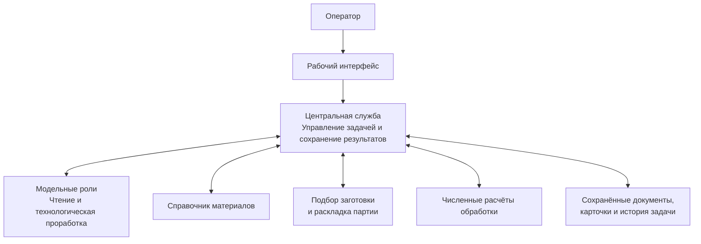
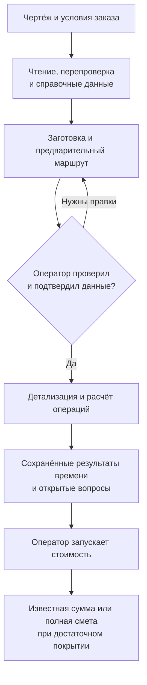

# Архитектура системы «Подготовка производства»

## Для чего нужна система

«Подготовка производства» помогает перейти от чертежа детали к обоснованному описанию её изготовления. Оператор передаёт исходный документ и условия заказа, а система извлекает сведения о детали, подбирает справочные основания и заготовку, предлагает последовательность операций и рассчитывает поддержанные работы. После проверки результатов оператор отдельно запускает расчёт стоимости.

На выходе получается несколько связанных результатов: описание детали, выбранная заготовка, предварительный маршрут, результаты операций и денежная оценка. Они появляются последовательно и имеют разную степень готовности. Прочитанный чертёж ещё не означает готовую технологию, а рассчитанное время нескольких проходов ещё не означает полную смету.

Система сохраняет неизвестные величины. Если не хватает размера отверстия, нормы вспомогательной работы или цены материала, это остаётся открытым вопросом. Известная часть расчёта при этом может быть полезна: например, можно видеть время наружного точения и его стоимость, пока полная стоимость детали ещё не определена.

## Кто участвует в работе

Оператор отвечает за постановку задачи, проверку исходных данных, выбор допустимой заготовки и явное подтверждение продолжения. Он может исправить прочитанное значение, уточнить количество или вернуть предварительную карту на пересмотр. Сохранение правки и подтверждение перехода к детализации — разные действия.

Центральная служба управляет всей последовательностью. Она знает, какие данные уже получены, какой результат относится к текущей задаче и какой шаг можно выполнять дальше. Через неё проходят обращения к моделям и специализированным расчётным сервисам. Она же сохраняет результаты и собирает стоимость.

Языковые модели работают в четырёх ролях: читают чертёж, перепроверяют чтение, предлагают предварительный маршрут и детализируют принятые операции. Это роли внутри общего процесса, а не четыре самостоятельных микросервиса. Модель помогает понять источник и состав работ; численные формулы исполняет обычная расчётная программа.

Специализированные сервисы решают ограниченные задачи. Один предоставляет сведения о материалах, второй выбирает поддержанную заготовку и раскладывает партию, третий рассчитывает конкретные движения обработки. Ни один из них самостоятельно не ведёт весь заказ от чертежа до цены.

## Из каких частей состоит система

Оператор работает в едином интерфейсе. В нём загружаются документы, проверяются данные детали, просматриваются заготовка и маршрут, принимаются решения и показываются результаты. Вычисления выполняются за этим интерфейсом; открытие вкладки само по себе не является подтверждением технологии.

Главный организатор работы — центральная служба Metall. Она соединяет входной документ, справочники, модельные роли, оборудование и расчёты в одну задачу. Карточки станков и их ставки относятся к этой службе.

| Часть системы | Что получает | За что отвечает |
| --- | --- | --- |
| Интерфейс оператора | Файл, условия заказа, исправления и подтверждения | Показывает текущую задачу и передаёт решения оператора |
| Центральная служба Metall | Задачу и результаты всех этапов | Управляет порядком действий, проверяет применимость, сохраняет данные и собирает стоимость |
| Сервис материалов Splav | Марку материала и запрос нужных свойств | Возвращает доступные справочные сведения и их происхождение |
| Сервис подбора stock-selection | Форму, размерную потребность, количество и условия поставки | Выбирает поддержанный прокат, длину отрезка и комплект прутков, рассчитывает материальную раскладку |
| Сервис расчётов machining-calc | Геометрию конкретного движения, режим и коэффициенты | Вычисляет время, объём съёма и другие поддержанные показатели либо количество событий партии |
| Модельные роли | Источник и контекст соответствующего этапа | Читают, перепроверяют и формируют технологическое содержание |

Стрелки показывают ответственность за обмен. Сервисы подбора и обработки не передают друг другу весь заказ напрямую. Центральная служба получает результат одного этапа и готовит из него вход для следующего. Так можно отличить ошибку чтения от отсутствующей нормы, а неподходящую заготовку — от недоступного расчёта.

## Как задача проходит от чертежа до результата

### Загрузка и подготовка документа

Оператор загружает чертёж и задаёт известные условия заказа, в том числе количество деталей. Система сохраняет исходный файл и готовит изображение для чтения. Для многостраничного документа важно понимать, какая страница обрабатывается; для изображения подготавливается пригодное растровое представление.

Подготовка изображения меняет его техническое представление, но не создаёт размеры детали. Миллиметры берутся из размерных обозначений и подтверждённых данных, а не из произвольного измерения длины линии на экране.

### Чтение и перепроверка

Первая модельная роль извлекает реквизиты, материал, размеры, требования и признаки исходной заготовки. Вторая роль получает тот же источник и первое чтение, после чего проверяет его и предлагает исправления. Центральная служба применяет допустимые изменения и сохраняет их основание.

Перепроверка помогает выявить пропуски и сопоставить спорные значения с источником. Плохо различимый знак при этом может остаться неопределённым. Если источники противоречат друг другу или символ нельзя уверенно прочитать, задача должна сохранить этот вопрос для проверки. Результат этого этапа — структурированное описание детали с известными и неизвестными сведениями.

### Материал и справочные основания

По прочитанной марке система обращается к справочнику материалов. Он может предоставить плотность, твёрдость, механические свойства и другие доступные сведения. Наличие карточки материала не означает, что в ней заполнено любое необходимое свойство.

Справочные числа рассматриваются вместе с областью применения. Плотность нужна для перехода от объёма к массе; коэффициенты обработки — для соответствующего расчётного метода. Система не должна подменять отсутствующее свойство похожим числом без явного основания.

Если справочник временно недоступен, полезное чтение чертежа сохраняется. Зависимые результаты остаются неполными, а причина ограничения становится видимой. Вся задача не должна превращаться в выдуманный полностью заполненный ответ.

### Подбор заготовки

Текущий основной сервис подбора рассчитан на сплошной круглый прокат с длиной поставки 6 или 12 метров. Он определяет размерную потребность детали, учитывает торцевые припуски, условия отрезки, отклонения и кривизну проката, затем проверяет пригодность доступных диаметров.

Сначала выбирается минимальный подходящий диаметр. Для него сервис ищет комплект прутков: первый критерий — минимальная закупаемая номинальная длина, второй — меньшее число прутков. Это не поиск минимальной цены в рублях: коммерческие цены в этот подбор не входят.

Результат объясняет, сколько отрезков можно получить, сколько прутков потребуется, какой материал уйдёт в пропилы и начальные обрезки и что останется после раскроя. Пруток поставки, отрезок под одну деталь, пропил и остаток — разные составляющие баланса.

Если на чертеже уже назначена заготовка, она сохраняет собственный смысл. Рассчитанная альтернатива не становится принятой автоматически. Оператор должен видеть различие между исходным назначением и рекомендацией системы и принять решение по актуальным данным.

В проекте существуют дополнительные и прежние алгоритмы для других форм. Их наличие не расширяет автоматически основной сервис. Если текущий путь не поддерживает форму детали или заготовки, система должна сообщить об ограничении, а не выдать условную раскладку за выполненный подбор.

### Предварительный маршрут

После чтения и справочной подготовки модель планирования предлагает последовательность операций. Она опирается на данные детали, материал, заготовку и обнаруженные ограничения. Маршрут показывает, какие виды обработки предполагаются и в каком порядке они могут выполняться.

Это предварительная карта, предназначенная для проверки. Она ещё не содержит доказанного полного расчёта каждой работы. Например, наличие операции сверления не означает, что известны глубины всех отверстий, режимы, свободные движения и время вспомогательных действий.

### Проверка оператором

Перед детализацией оператор проверяет описание детали и предварительную карту, исправляет спорные значения и принимает применимые ограничения. Важно, чтобы подтверждение относилось к текущим данным: после существенного изменения размера, количества или заготовки прежнее решение может утратить основание.

Система допускает дальнейшую проработку только при достаточном состоянии задачи. Непринятая рекомендация заготовки, неподдержанная область или зависимое изменение количества могут потребовать дополнительной проверки. Это позволяет не строить подробные проходы по уже устаревшему маршруту.

### Детализация и численные расчёты

После подтверждения модель детализации раскрывает содержание принятых операций: работы, установки, оснащение, технологические цели и основания режимов. Одна такая роль работает с операциями принятой карты. Она не заменяется отдельным агентом на каждую математическую формулу.

Затем обычная программа связывает цели с размерами, применяет режимы и строит поддержанные проходы. Сервис расчётов получает конкретные задания: например, один продольный слой точения, радиальный врез канавки или один пильный рез. Он возвращает показатели в своей области — время, объём, производительность, а для поддержанных моделей также силы и мощность.

Дополнительные движения и вспомогательное время требуют собственных оснований. Подход, возврат инструмента, загрузка прутка и общая наладка не должны незаметно исчезать из полного времени. При этом работа, уже включённая в другой расчёт или общую норму, не начисляется повторно.

Обычная новая детализация заканчивается сохранением результатов операций. На этом шаге можно получить известные минуты и перечень непокрытых работ. Полный автоматический прогноз всех оставшихся действий и денежная смета не являются обязательным продолжением каждого такого запуска.

### Отдельный расчёт стоимости

Стоимость оператор запускает отдельно, когда есть применимые сохранённые результаты операций. Центральная служба берёт их временные основания и текущие ставки назначенных станков, формирует денежные строки и проверяет полноту.

Повторяемые работы распространяются на количество деталей. Общие работы партии учитываются один раз, а общая наладка не дублируется из-за того, что её используют несколько операций. Материал, обработка, включённые услуги и резерв сохраняют разные основания.

К известной обработке однократно применяется коэффициент надбавки. Материал и зачёт стоимости материала в эту базу не входят. Суммы разных валют и разных ценовых оснований не складываются в одно число без отдельного правила. Отсутствующая цена материала или необходимый резерв не заменяются нулём ради получения полного итога.

Есть и отдельное действие пересчёта по карточкам станков: оно сначала обновляет технический расчёт по сохранённым входам, затем стоимость. Изменение только ставки не требует заново читать чертёж или просить модель повторно придумать технологию.

## Как части системы понимают друг друга

Каждый обмен имеет ограниченную цель. Запрос к материалам содержит обозначение материала и потребность в свойствах; ответ возвращает найденные сведения, а не готовый маршрут. Запрос подбора описывает форму, размеры, количество и условия поставки; ответ возвращает заготовку и материальный баланс, а не минуты изготовления.

Расчёт обработки получает геометрию одного задания и режим. Его результат относится именно к этому заданию. Время пильного реза нельзя применить к другому диаметру, а ответ по прежней геометрии — к исправленному чертежу. Центральная служба проверяет соответствие сохранённого результата его исходным данным.

При сборке стоимости используются не только успешно рассчитанные строки, но и перечень необходимых работ. Поэтому отсутствующая операция остаётся видимой, даже если у неё нет минут или цены. Простое сложение найденных чисел не может доказать полноту сметы.

## Что сохраняется и почему результаты могут устареть

В задаче сохраняются исходный документ, чтение и исправления, сведения о материале, решения по заготовке, принятая карта, результаты детализации, численные расчёты и денежная оценка. Отдельно ведётся история действий и оснований. Служебный просмотр этой истории помогает разбирать ход работы, но сам не участвует в выборе режимов или начислении цены.

Сохранённый результат относится к конкретному состоянию задачи. Если после расчёта изменён диаметр, число деталей, назначенный станок или его рабочие режимы, зависимые результаты могут потребовать обновления. Если меняется ставка, в первую очередь устаревает денежная часть. Система должна различать эти последствия, чтобы не пересчитывать всё без необходимости и не оставлять недействительный итог как текущий.

Поздно пришедший ответ не должен затирать более новое решение оператора. Отмена или прерывание этапа также не означает, что все ранее полученные полезные данные потеряны. Сохраняется достигнутое состояние и причина остановки; продолжение должно опираться на проверенные актуальные входы.

## Как понимать готовность результата

Известное время означает, что рассчитаны конкретные охваченные движения. Полное время означает, что достаточно покрыты все необходимые работы в рассматриваемой области. Эти результаты могут различаться даже для одной операции.

Известная стоимость означает сумму обоснованных денежных строк. Полная смета требует достаточного материала, работ, времени, ставок и необходимого резерва. Можно получить полезную известную сумму обработки и одновременно не знать полного итога заказа.

Даже полностью заполненный расчёт остаётся отдельным от производственной приёмки. Применимость закрепления, инструмента и режимов к реальному оборудованию, качество исходного чертежа и технологические ограничения требуют собственного основания. Система помогает сделать эти основания понятными и сохраняемыми; она не превращает отсутствие информации в разрешение на изготовление.
