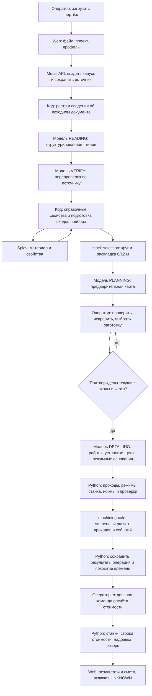
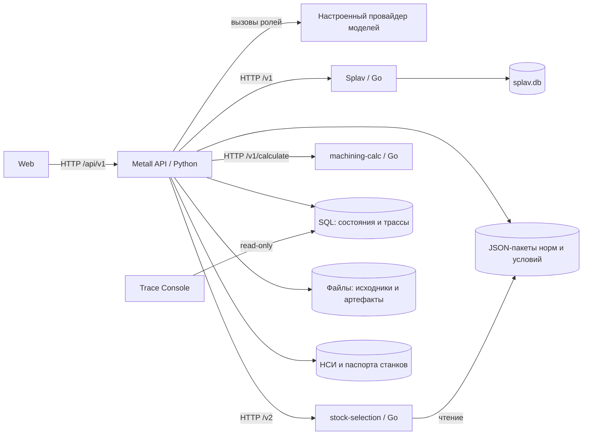
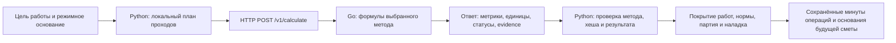

# От чертежа до сметы

Дата: 06.11.2026. Основание и границы: [README](README.md), [реестр снимка](04-SOURCES-AND-COVERAGE.md).

## 1. Общая картина

Оператор загружает чертёж через Web. Metall сохраняет источник, вызывает чтение и перепроверку, получает справочные свойства и подбор заготовки, затем строит предварительную карту операций. Оператор проверяет и подтверждает входы и карту. После этого модель формирует технологический замысел детализации, Python разворачивает поддержанные работы в проходы, Go рассчитывает их численные показатели. Python собирает время и денежные строки, сохраняет результат и показывает его в интерфейсе. Неполные данные дают частичный результат с явными неизвестными величинами.

Стрелки показывают логическую зависимость, а не отдельный сервер для каждого блока. Роли READING/VERIFY/PLANNING/DETAILING вызываются одним Python backend через настроенного провайдера. Для успешного обычного compact-прохода это четыре этапа модельного исполнения, но не гарантия ровно четырёх сетевых запросов провайдеру: транспорт и внутренние инструменты модели имеют собственное выполнение.

Источники: [вход API](F:/projects/metall-dev-2/mvp/src/metall_mvp/api/routes_parts/recognition.py:553), [начальный workflow](F:/projects/metall-dev-2/mvp/src/metall_mvp/workflows/compact_round.py:1013), [единый вызов роли](F:/projects/metall-dev-2/mvp/src/metall_mvp/workflows/compact_round.py:552), [детализация](F:/projects/metall-dev-2/mvp/src/metall_mvp/workflows/compact_round.py:1224).

## 2. Процессы и микросервисы

Порты ниже заданы для рабочего режима общего запускателя. Временная среда использует свободные порты. Это конфигурация, а не свидетельство, что процессы сейчас запущены.

| Компонент | Исполнение | Вход | Выход и ответственность |
| --- | --- | --- | --- |
| Web, `:5173` | React/TypeScript; отдельный dev-процесс | Действия оператора, файл, количество, правки, подтверждения | Запросы `/api/v1`; показ паспорта, заготовки, карты, уточнений, времени и сметы |
| Metall API, `:8766` | Python/FastAPI | HTTP-команды UI | Оркестрация, модели, паспорт, НСИ, станки, версии, расчётные адаптеры, хранение, итог сметы |
| `splav-parser`, `:8775` | Go, отдельный HTTP-сервис | Поиск марки, запрос свойств | Каталог материалов, источники, состав, механические свойства, твёрдость, плотность при наличии данных; HTTP/MCP и UI каталога |
| `stock-selection`, `:8789` | Go, отдельный HTTP-сервис | Контракт `stock-selection/2`, распознанная форма, размерные потребности, количество, ссылки на неизменяемые пакеты норм/условий | Выбранный круг, длина отрезка, комплект прутков 6/12 м, материальный баланс, неподдержанные формы и ограничения |
| `machining-calc`, `:8788` | Go, отдельный HTTP-сервис | Метод/версия, геометрия, режим, коэффициенты и происхождение операндов | Геометрия съёма, кинематика, время, поддержанные нагрузки либо события партии; собственные состояния отдельных метрик |
| Trace Console, `:8077` | Python, отдельная диагностическая утилита | ID запуска и чтение трассы | Просмотр истории, событий, артефактов, вызовов моделей; в основной расчёт не вмешивается |

Связь UI с backend: [useRuns.ts](F:/projects/metall-dev-2/web/src/api/hooks/useRuns.ts:349), [прокси Web](F:/projects/metall-dev-2/web/vite.config.ts:18). Конфигурация процессов: [dev_stack.py](F:/projects/metall-dev-2/mvp/scripts/dev_stack.py:335). Подключение клиентов: [main.py](F:/projects/metall-dev-2/mvp/src/metall_mvp/main.py:150).

### Границы сервисов

Расчётный Go-сервис и сервис подбора не вызывают модель вместо backend. Встроенный UI и MCP являются дополнительными интерфейсами тех же ядер, а не отдельными сервисами расчёта в штатной цепочке.

`stock-selection` читает опубликованные JSON-пакеты по проверенным ссылкам и хешам. Он не читает паспорт или рабочую SQL-базу Metall напрямую. Python публикует пакеты и сохраняет кэш ответов, проверяя версию capabilities и хеш входа. События операций, минуты и цены не входят в материальную раскладку v2. Источники: [клиент](F:/projects/metall-dev-2/mvp/src/metall_mvp/workflows/stock_selection.py:253), [загрузка пакетов](F:/projects/metall-dev-2/stock-selection/selection/engine.go:27), [HTTP](F:/projects/metall-dev-2/stock-selection/selection/http.go:48).

`machining-calc` получает конкретное вычислительное задание. Он не выбирает весь маршрут, заготовку или коммерческую ставку. Его каталог содержит девять методов; это не девять обязательных вызовов. Основной backend вызывает только методы, для которых сформированы задания. Источники: [каталог](F:/projects/metall-dev-2/machining-calc/catalog/catalog.go:189), [адаптер](F:/projects/metall-dev-2/mvp/src/metall_mvp/workflows/machining_adapter.py:217).

Паспорта оборудования принадлежат Metall: `machine_passports.db`. Старое машинное хранилище Splav отключено кодом; наличие старых обработчиков `/v1/machines` не делает его действующим источником станков. Источники: [создание сервиса паспортов](F:/projects/metall-dev-2/mvp/src/metall_mvp/main.py:78), [отказ прежней базы Splav](F:/projects/metall-dev-2/splav-parser/cmd/splav-parser/main.go:75).

## 3. Запрос оператора и подготовка источника

1. Web создаёт `FormData`, передаёт файл, проект, документ, профиль провайдера и `pipeline_mode`. Значение по умолчанию: `compact_round`.
2. `POST /api/v1/runs/recognition/start` проверяет непустой файл, создаёт `processing_run`, сохраняет начальный `CompactState` и возвращает `202` с `run_id`.
3. FastAPI ставит `read_and_plan` в `BackgroundTasks`. Отдельного внешнего брокера или самостоятельного сервиса очередей на этом участке кода нет.
4. Код сохраняет артефакт `source_document`, вызывает `image.prepare_raster_page` и `document.inspect_source`.
5. Для PDF передаются оригинал и индекс источника; для изображения доступен подготовленный растр. Само распознавание не создаёт у обычного PNG/JPEG независимый исходный текстовый слой.

Выход: сохранённый источник, растр, сведения о документе и контекст для чтения. Геометрия детали этим ещё не подтверждена. Источник: [prepare_reading_source](F:/projects/metall-dev-2/mvp/src/metall_mvp/workflows/compact_round.py:934).

## 4. Чтение, перепроверка и справочные данные

| Шаг | Условие запуска | Вход | Исполнитель | Выход |
| --- | --- | --- | --- | --- |
| READING | Подготовлен новый источник | Растр, исходный PDF/индекс при наличии, инструкция | Модель | `CompactReading`: реквизиты, материал, размеры, требования, признаки заготовки и области применимости |
| VERIFY | Первое чтение сохранено, состояние `checking` | Тот же источник и первое чтение | Модель, затем обычный код применения проверенных правок | `ReadingVerification`, изменённое чтение, список изменений, новое основание чтения |
| Enrichment | Есть чтение | Паспортная проекция и НСИ | Python, обращения к Splav и stock-selection | Свойства и свидетельства материала, подбор, раскладка, ограничения, расчётные настройки |
| PLANNING | Текущая область не признана `unsupported` | Чтение, материал, выбранная/рекомендуемая заготовка, ограничения | Модель | `CompactRoute`, состояние `review`, запрос проверки оператором |

VERIFY является повторным модельным прочтением, а не доказательством истинности спорного глифа. Известные конфликты и неизвестные данные сохраняются. Отказ справочника не должен уничтожать полезное чтение: `enrich` сохраняет неизвестный подбор и диагностические ограничения. Неподдержанная форма прекращает поддержанный круглый проход, вместо создания фиктивного решения.

Источники: [verify_reading](F:/projects/metall-dev-2/mvp/src/metall_mvp/workflows/compact_round.py:896), [enrich](F:/projects/metall-dev-2/mvp/src/metall_mvp/workflows/compact_round.py:408), [generate_route](F:/projects/metall-dev-2/mvp/src/metall_mvp/workflows/compact_round.py:625).

## 5. Заготовка и материальная раскладка

Поддержанный метод сервиса: `round-bar/1`. Допустимые длины поставки: 6000 и 12000 мм. Иные известные формы присутствуют в контракте, но не получают синтетического расчёта.

Сервис выполняет следующие действия:

1. Проверяет происхождение параметров и пакетов, версию контракта, материал и форму.
2. Формирует размерную потребность по подтверждённому верхнему пределу либо явно отмеченному номинальному основанию.
3. Считает минимальную длину отделяемого отрезка с торцевыми припусками, погрешностью реза и шагом упора при его наличии.
4. Проверяет эффективный диаметр с учётом нижнего отклонения и кривизны.
5. Проверяет вместимость прутка с учётом начальной обрезки, её пропилов и зажимного остатка.
6. Выбирает минимальный подходящий номинальный диаметр; для него выбирает комплект поставки сначала по минимальной закупаемой длине, затем по количеству прутков.
7. Возвращает `piece`, `selected_stock`, `batch_plan`, `material_balance`, ограничения и потребность в подтверждениях.

Формулы: [раздел 3 каталога](02-FORMULAS.md#3-подбор-круга-и-раскладка-партии). Исходники: [engine.go](F:/projects/metall-dev-2/stock-selection/selection/engine.go:233), [layout.go](F:/projects/metall-dev-2/stock-selection/selection/layout.go:5), [Optimize](F:/projects/metall-dev-2/stock-selection/selection/decimal.go:96).

Назначенная на чертеже заготовка и альтернативная рекомендация являются разными сущностями. Новая рекомендация не должна молча становиться принятой заготовкой. Физический пруток, отделённый отрезок, пропил и остаток также не взаимозаменяемы. Потери неизвестной дополнительной подготовки не объявляются учтёнными.

## 6. Что подтверждает оператор

В текущем compact-пути UI вызывает `POST /api/v1/runs/{run_id}/compact-round/confirm` с `expected_revision`, `confirm_inputs`, принятыми ограничениями и признаком явного повтора детализации.

Подтверждение допускается, когда есть поддержанное чтение и непустая предварительная карта, задача не выполняется/не отменена, нет непринятой рекомендации заготовки и нет зависимого изменения количества, требующего новой карты. Фиксируются точное основание входов и карты, проверенная ревизия, актор, ограничения, ревизия и хеш каталога станков. Детализация повторно проверяет действительность этого основания.

Сохранение исправления, выбор карточки, открытие вкладки и просмотр результата сами по себе не равны подтверждению DETAIL. После изменения основания прежний ответ нельзя применить как текущий. Источник: [confirm_compact](F:/projects/metall-dev-2/mvp/src/metall_mvp/api/routes_parts/compact_round.py:438).

В исторической ветви D001 существуют отдельные G1/G2 и операции выдачи задач. Они сохранены как другой путь API; основную схему выше нельзя описывать как их неизменённое продолжение. В compact-пути предварительная PLANNING-карта уже построена к моменту показанного подтверждения.

## 7. Детализация: что решает модель, что считает код

Новый рабочий контракт: `compact-detail-intent/1`. Одна роль DETAILING получает принятую карту и возвращает технологические намерения для её операций. В этом вызове нет отдельного модельного исполнителя на каждый Go-метод.

| Модель DETAILING | Python Metall | Go machining-calc |
| --- | --- | --- |
| Определяет состав работ, установки, оснащение, технологические цели и уникальные семантические пробелы | Переводит intent в совместимое расчётное представление `CompactDetail` | Проверяет контракт конкретного метода |
| Выбирает станок/комплектацию и режимные основания из переданного контекста | Применяет режимные числа и ограничения карточки оборудования | Выводит зависимые обороты/скорости и подачи |
| Привязывает цели к размерам и работам | Строит слои, проходы и новые полосы съёма в поддержанной области | Считает геометрию одного задания, время, нагрузки поддержанных методов |
| Явно оставляет неподдержанные технологические решения | Сохраняет `unresolved_goals`, проверяет цепочки и покрытие работ | Возвращает `known`, `unknown`, `invalid`, `not_applicable` по метрикам |
| Не выдаёт собственную смету, ручные физические проходы и численные минуты в новом intent | Применяет нормы вспомогательного времени, количество и ставки | Не выбирает всю технологию и не назначает цену |

Модельные параметры не становятся подтверждёнными производственными данными только из-за прохождения JSON-контракта. Исходники: [контракт](F:/projects/metall-dev-2/mvp/src/metall_mvp/domain/compact_detail_intent.py:1), [модельный вызов](F:/projects/metall-dev-2/mvp/src/metall_mvp/workflows/compact_round.py:1224), [prepare_operation](F:/projects/metall-dev-2/mvp/src/metall_mvp/workflows/compact_estimation.py:277).

## 8. Расчёт проходов и времени

Код отдельно суммирует известное машинное время и проверяет возможность полного времени операции. Наличие нескольких известных проходов не делает неизвестные работы выполненными. Для резьбы при достаточных данных учитывается цикл с явно заданным возвратом. События резки партии не подменяются временем одного реза.

Обычные зависимости: `t=L/u`, `u=nf`, `n=1000v/(πDref)`. Для ленточной пилы используется `t=(A/100)/R`, где `R` в см²/мин; скорость полотна не заменяет производительность. Дополнительные минуты назначаются только по применимым основаниям. Общая наладка учитывается один раз на свою группу.

Источники: [calculate_details](F:/projects/metall-dev-2/mvp/src/metall_mvp/workflows/compact_round.py:1377), [адаптер HTTP](F:/projects/metall-dev-2/mvp/src/metall_mvp/workflows/machining_adapter.py:217), [локальные проходы](F:/projects/metall-dev-2/mvp/src/metall_mvp/domain/estimation/pass_planning.py:351), [снимок времени](F:/projects/metall-dev-2/mvp/src/metall_mvp/domain/estimation/time_estimate.py:265).

Новый обычный вызов DETAIL сохраняет результаты операций; по умолчанию `legacy_estimate=False`, `estimate={}`, `cost_estimate=None`, `time_estimate=None`. Это не сборка полной сметы и не автоматический сценарий оставшихся работ. Последний вызывается отдельными совместимыми командами: применяет закреплённые профили и строит базовую/верхнюю оценку. Он не дописывает исходную геометрию как подтверждённый факт. Основание: [параметр вызова](F:/projects/metall-dev-2/mvp/src/metall_mvp/workflows/compact_round.py:1313), [сохранение результатов](F:/projects/metall-dev-2/mvp/src/metall_mvp/workflows/compact_round.py:1626). Формулы вынесены в [дополнительный каталог](03-ADDITIONAL-FORMULAS.md).

## 9. Сборка сметы

Основание сметы состоит из инвентаря работ, строк времени/цены, количества, ставок станков, политики надбавки и резервных групп. Строки различают `per_piece` и `per_batch`, известное и неизвестное время, обязательные и включённые работы.

В текущем UI стоимость запускается отдельной кнопкой через `POST /api/v1/runs/{run_id}/compact-round/cost-estimate`. Обработчик использует сохранённые `details` и текущие ставки карточек, затем сохраняет `cost_estimate`; нового DETAIL или расчёта проходов эта команда не запускает. `machine-estimate` отдельно пересчитывает сохранённые геометрические входы по карточкам и после этого собирает стоимость. Само чтение `GET .../compact-round` ничего не досчитывает. Источники: [кнопка стоимости](F:/projects/metall-dev-2/web/src/components/route/CompactCostEstimate.tsx:90), [обработчики](F:/projects/metall-dev-2/mvp/src/metall_mvp/api/routes_parts/compact_round.py:671), [чтение состояния](F:/projects/metall-dev-2/mvp/src/metall_mvp/api/routes_parts/compact_round.py:138).

1. Ставка назначенного станка берётся из его карточки с коммерческим основанием.
2. Для обработки считается `C=t·Rчас/60`; для количественной позиции `C=q·p`; прямой денежный ввод сохраняет собственное основание.
3. Повторяемая строка умножается на количество деталей, общая строка партии учитывается один раз. Дубликаты общей наладки и явно включённые работы не начисляются повторно.
4. Суммы группируются по валюте и ценовому основанию. Автоматической конвертации валют нет.
5. Надбавка применяется один раз к известной обработке; материал и возврат стоимости материала из её базы исключены.
6. Резерв считается по выбранному правилу. Отсутствие резерва или обязательной цены не заменяется нулём.
7. Отдельно формируются известная база, надбавка, промежуточная сумма, резерв и полный итог. `total_state=partial` или `unknown` остаётся допустимым честным результатом.

Синтетическое происхождение `mock/demo/fixture` не принимается как коммерческая цена; независимое время сохраняется. Материальная раскладка сама по себе не означает, что стоимость материала найдена и включена в смету. Источники: [cost_inputs](F:/projects/metall-dev-2/mvp/src/metall_mvp/workflows/compact_estimation.py:1251), [build_cost_snapshot](F:/projects/metall-dev-2/mvp/src/metall_mvp/workflows/compact_estimation.py:1540), [денежная сборка](F:/projects/metall-dev-2/mvp/src/metall_mvp/domain/estimation/estimate.py:224), [допуск коммерческих оснований](F:/projects/metall-dev-2/mvp/src/metall_mvp/domain/estimation/pricing.py:16).

Изменение ставки или коэффициента надбавки пересчитывает денежную часть по сохранённым техническим основаниям. Изменение режимов станка затрагивает технический расчёт и имеет отдельную команду. Источник: [cost-estimate и machine-estimate](F:/projects/metall-dev-2/mvp/src/metall_mvp/api/routes_parts/compact_round.py:671).

## 10. Сохранение, актуальность и показ результата

| Хранилище/представление | Что содержит |
| --- | --- |
| `trace.db`, SQL-таблицы `processing_runs`, `trace_spans`, `trace_events`, `artifacts` | Метаданные запусков, этапы, события, ссылки на артефакты |
| SQL-таблицы `compact_round_heads`, `compact_round_history` | Текущее и исторические состояния `CompactState`, JSON в поле `payload`, номер ревизии |
| Каталог артефактов | Исходный документ, растр, JSON-ответы ролей и дополнительные файлы; SQL-запись артефакта не равна его содержимому |
| `nsi_catalog.db` и отдельный research-каталог | Редактируемые нормативные данные, ссылки, исследования материала; CSV является проекцией/входом синхронизации, а не отдельным микросервисом |
| `machine_passports.db` | Паспорта и версии оборудования, характеристики, режимы и ставки |
| `splav.db` | Каталог материалов сервиса Splav |
| `stock-selection-packages` | Неизменяемые JSON-пакеты норм/условий и кэш ответов клиента подбора |
| UI | Проекция сохранённого состояния и результатов; таблица на экране не является SQL-таблицей |

Имена баз являются стандартными путями кода; конфигурация может их переопределять. Фактические рабочие базы в исследовании не открывались.

Сохранение compact-состояния использует ожидаемую ревизию и транзакцию. Отмена и изменение основания запрещают позднему ответу становиться текущим. После перезапуска предусмотрено восстановление статусов, но восстановленный статус не равен автоматическому разрешению заново вызывать модель.

Источники: [SQL и CompactStore](F:/projects/metall-dev-2/mvp/src/metall_mvp/workflows/compact_round.py:53), [трассировка](F:/projects/metall-dev-2/mvp/src/metall_mvp/db/repository.py:55), [настройки хранения](F:/projects/metall-dev-2/mvp/src/metall_mvp/config.py:164).

## 11. Что означает результат

`status=ready` у compact-состояния означает завершение данного workflow, а не подтверждение полной себестоимости и технологии производства. Полнота времени, геометрии, применимости оборудования, коммерческих оснований и покрытия обязательных работ проверяется отдельно.

Полная смета остаётся неизвестной, если не оценены обязательные работы, материал, время, ставки или необходимый резерв. Точные формулы не устраняют недостаточность исходного чертежа, непроверенную норму, неформализованную установку или неподдержанный процесс. Материалы этого комплекта подтверждают наличие реализации в снимке, без нового распознавания, расчёта рабочего задания и производственной приёмки.
