# Карта архитектуры «Подготовки производства»

Дата: 06.11.2026. Статус: описание реализованного основного пути `compact_round` по зафиксированному снимку кода. Ветка `test-2`, HEAD `d9329696188fb1ad9d103ac3ad55908e55d37856`, с незакоммиченными изменениями `compact-detail-intent/1`. Перед подготовкой карты проверено отсутствие содержательных изменений относящихся к ней исходников относительно снимка.

Карта читается сверху вниз: сначала назначение системы, затем исполнители, затем точные границы обмена. Русские подписи объясняют смысл, английские имена обозначают реальные поля, роли и адреса кода. Схемы показывают логические связи; отдельными микросервисами являются только явно обозначенные Go-сервисы.

## 1. Общая архитектура

### 1.1. Что получает оператор

Вопрос схемы: как задача на изготовление превращается в расчёт с проверяемыми основаниями?

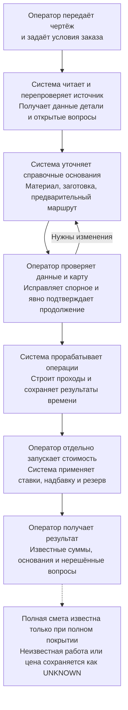

Основание: [начальный workflow](F:/projects/metall-dev-2/mvp/src/metall_mvp/workflows/compact_round.py:1013), [подтверждение](F:/projects/metall-dev-2/mvp/src/metall_mvp/api/routes_parts/compact_round.py:438), [сборка сметы](F:/projects/metall-dev-2/mvp/src/metall_mvp/domain/estimation/estimate.py:224).

### 1.2. Из каких приложений состоит система

Вопрос схемы: где находится управление процессом и какие задачи вынесены в сервисы?

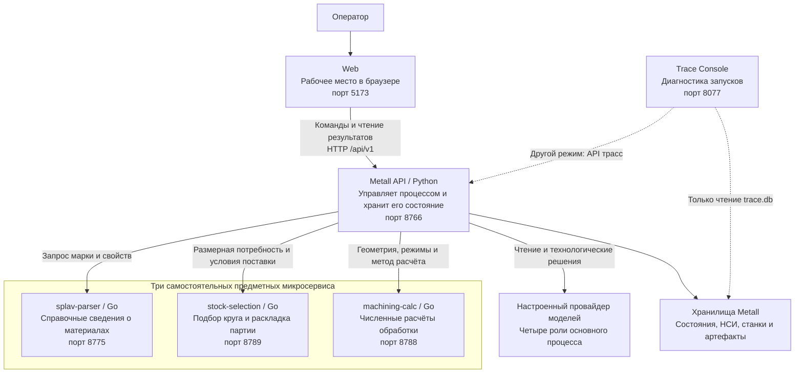

Порты относятся к конфигурации рабочего режима, а не к проверке запущенных сейчас процессов. Временный стенд выбирает свободные порты. Основание: [запускатель](F:/projects/metall-dev-2/mvp/scripts/dev_stack.py:335), [подключение компонентов](F:/projects/metall-dev-2/mvp/src/metall_mvp/main.py:150), [диагностическая консоль](F:/projects/metall-dev-2/trace-console/README.md).

### 1.3. Кто отвечает за сохранённые данные

Вопрос схемы: где исходные факты, где расчётный результат и где его доказательства?

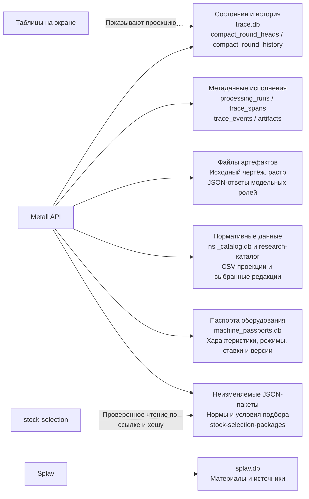

Имена баз являются стандартными путями; настройки могут их переопределять. Строка `artifacts` в SQL хранит метаданные, содержимое артефакта лежит в файле. Старое машинное хранилище Splav отключено; паспорта станков относятся к Metall. Основание: [CompactStore](F:/projects/metall-dev-2/mvp/src/metall_mvp/workflows/compact_round.py:53), [SQL-трассировка](F:/projects/metall-dev-2/mvp/src/metall_mvp/db/repository.py:55), [паспорта станков](F:/projects/metall-dev-2/mvp/src/metall_mvp/main.py:78), [отключение прежнего каталога](F:/projects/metall-dev-2/splav-parser/cmd/splav-parser/main.go:75).

## 2. Агентская архитектура

### 2.1. Четыре роли и их результаты

Вопрос схемы: какое решение принимает каждая модельная роль и что между ними делает обычная программа?

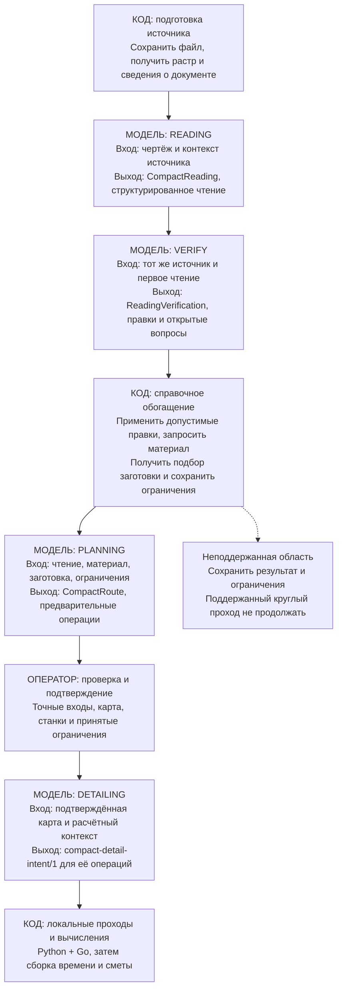

Это четыре роли в одном управляемом backend-процессе. Они не являются четырьмя сетевыми микросервисами и не передают задания друг другу напрямую. VERIFY является повторным модельным чтением, а не независимым доказательством правильности неразборчивого знака. Основание: [read_and_plan](F:/projects/metall-dev-2/mvp/src/metall_mvp/workflows/compact_round.py:1013), [контракты чтения и карты](F:/projects/metall-dev-2/mvp/src/metall_mvp/domain/compact_round.py:150), [generate_details](F:/projects/metall-dev-2/mvp/src/metall_mvp/workflows/compact_round.py:1224).

### 2.2. Как исполняется одна модельная роль

Вопрос схемы: кто передаёт инструкцию, проверяет ответ и сохраняет свидетельства?

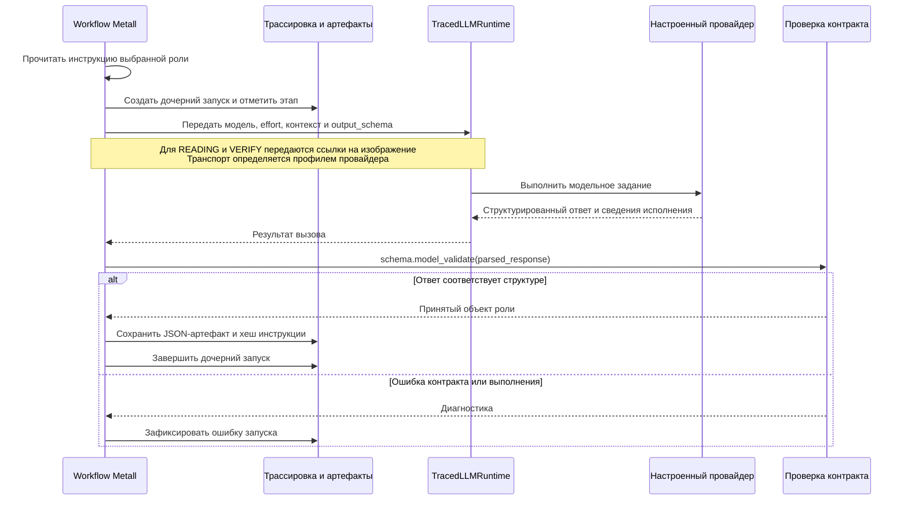

Структурная проверка не подтверждает физическую истинность ответа. В `ask` задан `max_attempts=1`; четыре этапа не означают гарантированно четыре внутренних сетевых обращения или действия инструментов провайдера. Основание: [ask](F:/projects/metall-dev-2/mvp/src/metall_mvp/workflows/compact_round.py:552), [провайдер и runtime](F:/projects/metall-dev-2/mvp/src/metall_mvp/main.py:190).

### 2.3. Где заканчиваются решения модели и начинаются расчёты

Вопрос схемы: почему технологическая детализация, численный расчёт и смета являются разными результатами?

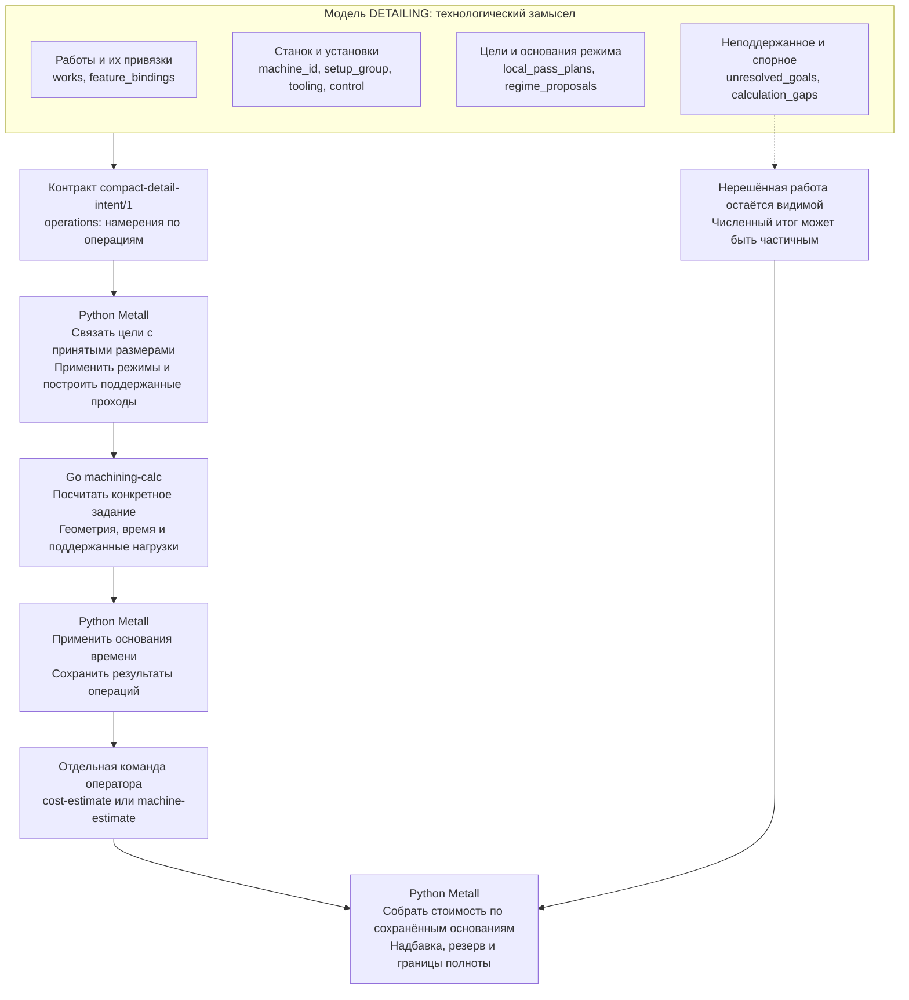

Новый модельный контракт не принимает готовую смету, собственные минуты и ручной список физических `passes`. Он преобразуется в совместимый `CompactDetail`; чтение прежних сохранённых результатов сохраняется. Основание: [compact_detail_intent.py](F:/projects/metall-dev-2/mvp/src/metall_mvp/domain/compact_detail_intent.py:51), [подготовка операций](F:/projects/metall-dev-2/mvp/src/metall_mvp/workflows/compact_estimation.py:277), [каталог Go-методов](F:/projects/metall-dev-2/machining-calc/catalog/catalog.go:189).

### 2.4. Почему подтверждение нельзя заменить автоматическим продолжением

Вопрос схемы: что должно совпасть, чтобы начать детализацию и применить её результат?

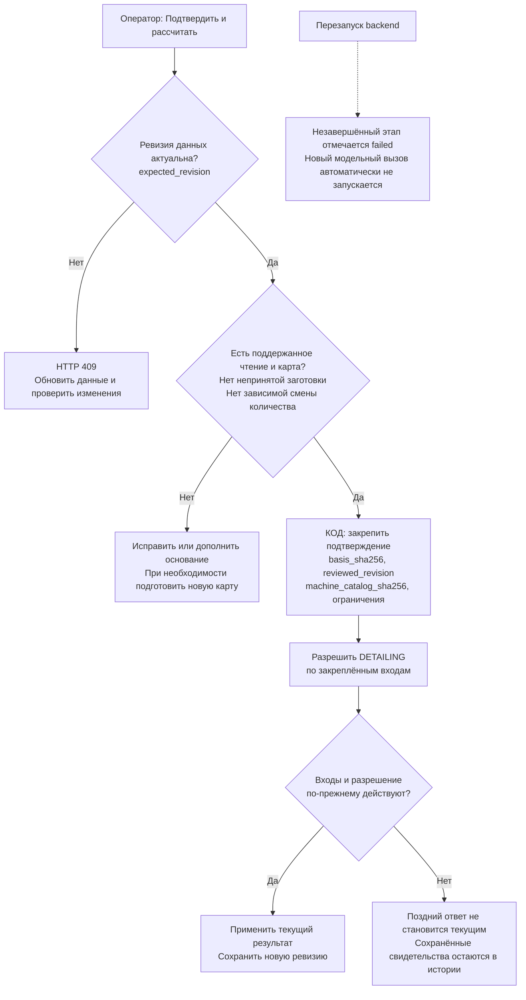

В этом compact-пути предварительная карта появляется до показанного подтверждения. Историческая схема D001 с отдельными G1/G2 остаётся другой ветвью API. Основание: [confirm_compact](F:/projects/metall-dev-2/mvp/src/metall_mvp/api/routes_parts/compact_round.py:438), [CompactStore](F:/projects/metall-dev-2/mvp/src/metall_mvp/workflows/compact_round.py:75), [восстановление после перезапуска](F:/projects/metall-dev-2/mvp/src/metall_mvp/workflows/compact_round.py:1676).

## 3. Взаимодействие микросервисов и их контракты

### 3.1. Последовательность обмена на основном пути

Вопрос схемы: когда нужен каждый сервис и кто вызывает следующий шаг?

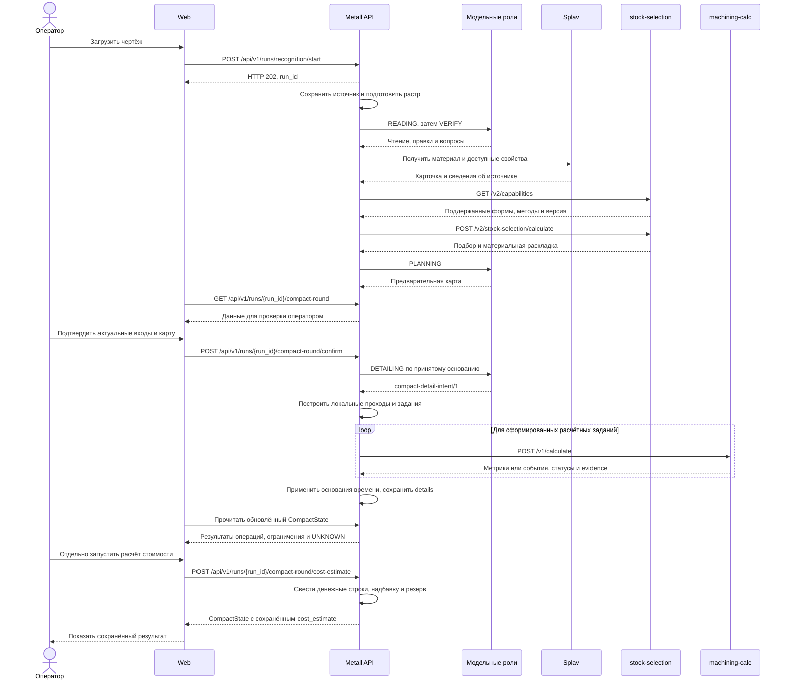

Схема показывает успешную логическую цепочку. Кэш может исключить повторный расчёт подбора; для Splav предусмотрены другие способы получения той же карточки. Новый DETAIL завершается результатами операций: `legacy_estimate=False`, `cost_estimate=None`, `time_estimate=None`. GET только читает состояние. Отдельный `machine-estimate` пересчитывает сохранённые входы по карточкам и затем стоимость; оценочные совместимые команды времени не являются автоматическим шагом новой загрузки. Неполные данные и отказы показаны отдельно в 3.8. Основание: [вход UI](F:/projects/metall-dev-2/web/src/api/hooks/useRuns.ts:349), [сохранение DETAIL](F:/projects/metall-dev-2/mvp/src/metall_mvp/workflows/compact_round.py:1637), [команды стоимости](F:/projects/metall-dev-2/mvp/src/metall_mvp/api/routes_parts/compact_round.py:671), [кнопка UI](F:/projects/metall-dev-2/web/src/components/route/CompactCostEstimate.tsx:90), [клиент подбора](F:/projects/metall-dev-2/mvp/src/metall_mvp/workflows/stock_selection.py:253), [HTTP-калькулятор](F:/projects/metall-dev-2/mvp/src/metall_mvp/workflows/machining_adapter.py:215).

### 3.2. Контракт Web → Metall API

Вопрос схемы: что означает принятие файла и какой командой оператор разрешает следующую модельную работу?

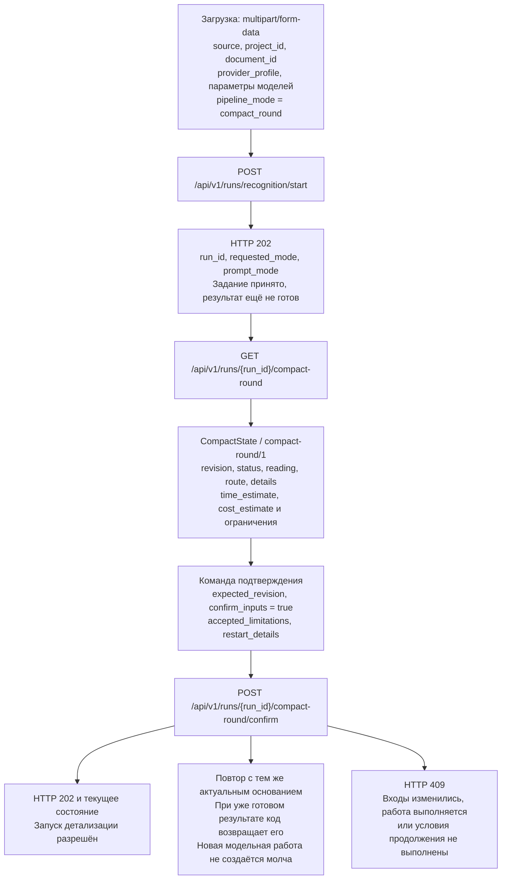

`revision` является версией состояния, `schema_version` является версией его структуры. Это разные понятия. Контракт полного API также сохранён в `mvp/openapi.json`. Основание: [recognition.py](F:/projects/metall-dev-2/mvp/src/metall_mvp/api/routes_parts/recognition.py:553), [CompactConfirmation](F:/projects/metall-dev-2/mvp/src/metall_mvp/domain/compact_round.py:557), [CompactState](F:/projects/metall-dev-2/mvp/src/metall_mvp/domain/compact_round.py:667).

### 3.3. Контракт Metall → Splav: материал и свойства

Вопрос схемы: как справочная марка превращается в набор свойств с сохранением происхождения?

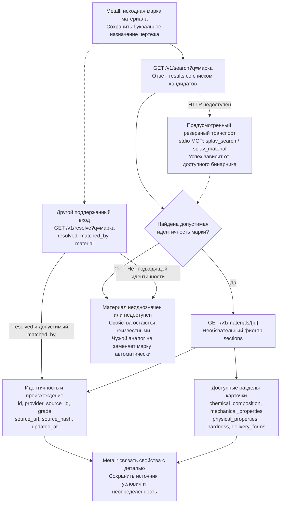

В схеме показаны основные используемые группы карточки; дополнительные необязательные разделы определены в Go-модели. `/v1` является версией HTTP-интерфейса, а не универсальным полем `schema_version` внутри карточки. Основание: [SplavMicroserviceClient](F:/projects/metall-dev-2/mvp/src/metall_mvp/tools/splav_client.py:139), [модель материала](F:/projects/metall-dev-2/splav-parser/internal/model/material.go:5), [идентичность в resolver](F:/projects/metall-dev-2/mvp/src/metall_mvp/tools/splav_client.py:196).

### 3.4. Контракт Metall → stock-selection: запрос

Вопрос схемы: какие факты и расчётные основания нужны, чтобы выбрать прутки?

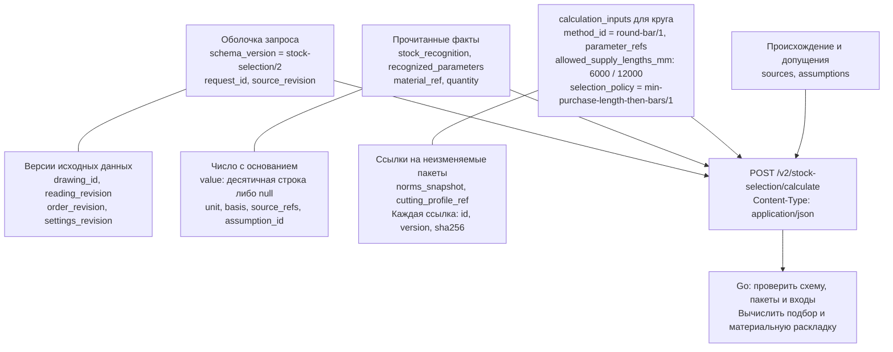

`quantity.value` является положительным целым либо `null`; остальные численные параметры используют свои типы свидетельств. `calculation_inputs` и отдельные ссылки могут быть `null` согласно схеме, что не даёт права считать отсутствующее основание нулём. Перед расчётом клиент читает `GET /v2/capabilities`; текущий поддержанный метод относится к `round_bar`. Основание: [types.schema.json](F:/projects/metall-dev-2/contracts/stock-selection/v2/types.schema.json), [HTTP-граница](F:/projects/metall-dev-2/stock-selection/selection/http.go:48).

### 3.5. Контракт stock-selection → Metall: результат

Вопрос схемы: что именно выбрано, какие ограничения остались и можно ли повторно использовать ответ?

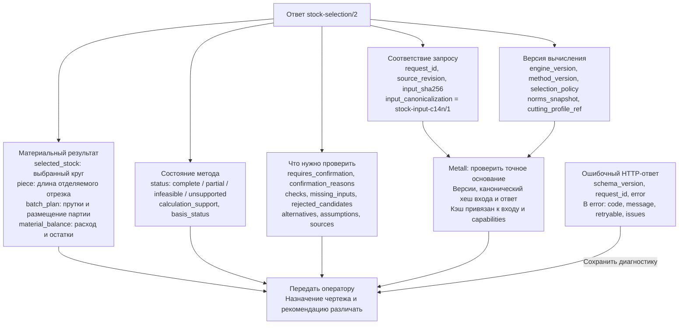

Статус `complete` здесь относится к подбору и материальному балансу, а не к готовой смете. Контракт v2 не возвращает операционные `cut_event_groups` и `handling_events`. Основание: [CalculationResponse и Error](F:/projects/metall-dev-2/contracts/stock-selection/v2/types.schema.json), [проверка и кэш клиента](F:/projects/metall-dev-2/mvp/src/metall_mvp/workflows/stock_selection.py:260).

### 3.6. Контракт Metall ↔ machining-calc

Вопрос схемы: как конкретное вычислительное задание связано с результатом и его формулой?

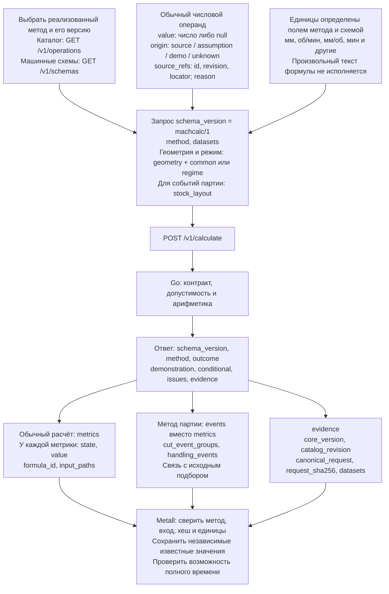

В снимке ядро `0.5.0`, каталог `machcalc-catalog/6`, девять методов. Десятичные длины специального `stock_layout` передаются строками согласно его собственному контракту, а не обычным `Input<T>`. Состояния `outcome`: `complete`, `partial`, `invalid`, `not_applicable`; состояния метрики: `known`, `unknown`, `invalid`, `not_applicable`. HTTP 200 не доказывает достаточность результата. Основание: [типы и версии](F:/projects/metall-dev-2/machining-calc/calc/types.go:10), [HTTP](F:/projects/metall-dev-2/machining-calc/internal/httpui/server.go:62), [специальный контракт партии](F:/projects/metall-dev-2/machining-calc/calc/bandsaw_batch.go:42), [проверка ответа](F:/projects/metall-dev-2/mvp/src/metall_mvp/workflows/machining_adapter.py:159).

### 3.7. Как раскладка превращается в события, время и стоимость

Вопрос схемы: почему нельзя получить производственное время или цену непосредственно из числа купленных прутков?

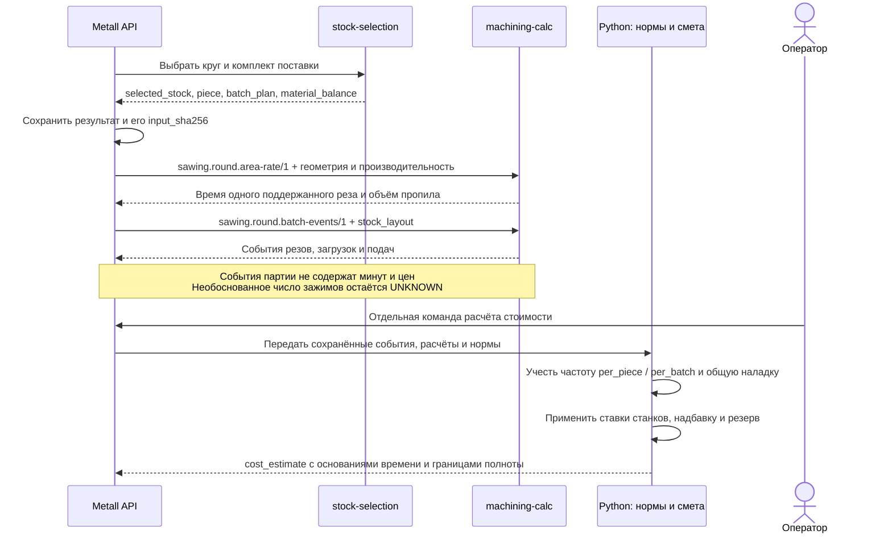

Сервисы не вызывают друг друга напрямую: перевод их результатов в следующие задания выполняет Metall. Показаны типы вычислений; конкретный набор вызовов зависит от сформированных работ и достаточности оснований. Основание: [контракт v2](F:/projects/metall-dev-2/contracts/stock-selection/v2/README.md), [проекция времени партии](F:/projects/metall-dev-2/mvp/src/metall_mvp/workflows/compact_estimation.py:1133), [расчётный workflow](F:/projects/metall-dev-2/mvp/src/metall_mvp/workflows/compact_round.py:1377).

### 3.8. Неполные данные, ошибки и актуальность

Вопрос схемы: чем отличаются отказ запроса, неизвестное значение и устаревший результат?

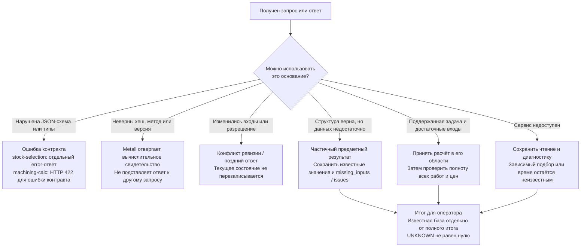

У ответов разных сервисов разные состояния и поля диагностики; схема не вводит для них общий новый JSON-контракт. `ready` в `CompactState` означает завершение workflow, а не производственную приёмку и не гарантированно полную цену. Основание: [stock HTTP](F:/projects/metall-dev-2/stock-selection/selection/http.go:48), [calc HTTP](F:/projects/metall-dev-2/machining-calc/internal/httpui/server.go:62), [ошибка отдельного прохода](F:/projects/metall-dev-2/mvp/src/metall_mvp/workflows/compact_round.py:1526), [полнота сметы](F:/projects/metall-dev-2/mvp/src/metall_mvp/domain/estimation/estimate.py:224).

## 4. Границы карты и связанные материалы

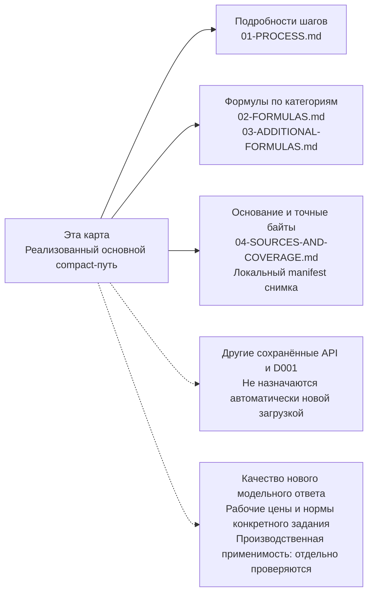

Документ описывает реализацию, а не проект новой системы. Рабочие базы и секреты не исследовались; модели и продуктовые API не запускались. [Описание процесса](01-PROCESS.md), [формулы основного пути](02-FORMULAS.md), [дополнительные формулы](03-ADDITIONAL-FORMULAS.md), [реестр снимка](04-SOURCES-AND-COVERAGE.md).
