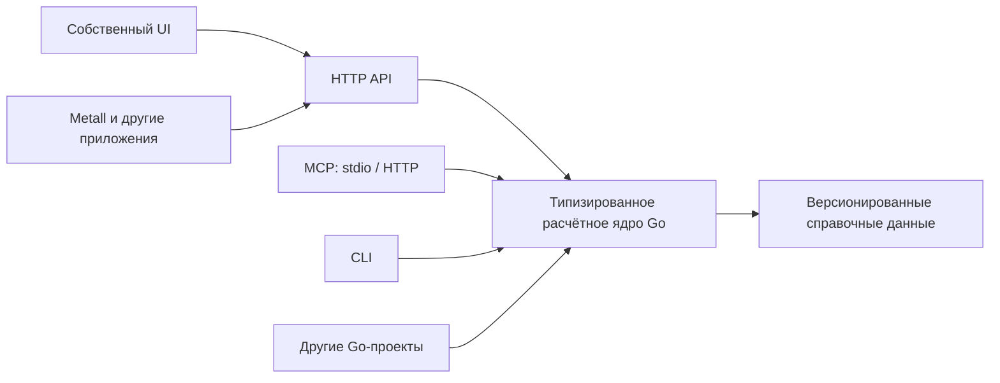

# Этап 3. Инженерные расчёты

Дата: 27.10.2026.

Статус выполнения плана: **Частично**, на 27.10.2026. Можно составить карту обработки, отредактировать её и получить описания отдельных операций. Полный расчёт изменения детали, времени и стоимости по утверждённой карте ещё не готов. Отдельный калькулятор обработки находится на стадии подготовки.

Цель: построить последовательность обработки детали, рассчитать изменения её геометрии и массы, определить режимы, время и стоимость операций. Расчётную часть выделить в самостоятельный калькулятор, которым можно пользоваться отдельно или подключать к другим программам.

Связанный документ: [план проверки данных и подтверждения карты операций](15-ПЛАН_РУЧНОГО_ПОДТВЕРЖДЕНИЯ_ЭТАПОВ_2026-10-27.md). Он описывает проверку исходных данных перед построением карты и проверку самой карты перед проработкой операций.

<!-- EXECUTION-STATUS-2026-10-27:BEGIN -->
## Статусы выполнения

Состояние на **27.10.2026**. **Выполнено**: результат готов и проверен. **Частично**: работает часть задачи. **Не выполнено**: требуемого результата пока нет. Основания проверок собраны в [подробностях реализации](#implementation-details).

| Задача | Готовность | Что сделано | Что осталось |
| --- | --- | --- | --- |
| Подготовка исходных данных | **Частично** | Передаются данные чертежа, материал, заготовка и справочник станков; рассчитываются исходные массы | Проверить достаточность описания поверхностей, баз и характеристик станков для расчёта |
| Построение карты обработки | **Частично** | Карту можно построить, изменить и подтвердить перед проработкой операций | Связать карту с полным расчётом и определить правила сравнения вариантов обработки |
| Подбор станка | **Частично** | Для операции выбирается станок и передаётся его паспорт | Проверять пригодность по размерам, массе и состоянию детали после каждой операции |
| Несколько операций на одном станке | **Выполнено** | Один станок может выполнять несколько операций одной карты; проверен пример с двумя токарными операциями | Доработки этого механизма не требуются |
| Геометрия и масса после обработки | **Частично** | Следующая операция получает результат предыдущей; рассчитываются простые формы и исходные массы | Рассчитывать снятый материал, полости и массу после каждой операции |
| Режимы и производительность | **Частично** | Предложенные параметры обработки сохраняются | Подбирать режимы по таблицам с учётом материала, инструмента и возможностей станка |
| Машинное время | **Частично** | Работают расчёты по длине и подаче, объёму и производительности | Добавить расчёт по площади и связать время с изменением геометрии детали |
| Вспомогательное и общее время | **Частично** | Различается работа на партию и на деталь; общая работа учитывается один раз | Определить состав вспомогательных работ для каждого способа обработки и связать с картой |
| Стоимость обработки | **Частично** | Время умножается на заданную ставку с учётом количества деталей | Получать обоснованные ставки станков и рассчитывать стоимость по утверждённой карте |
| Проверка готовности детали | **Частично** | Требования к операциям и нерешённые вопросы сохраняются | Проверять итоговую форму, размеры, допуски и шероховатость расчётом |
| Общий расчёт времени и стоимости | **Частично** | Есть отдельный расчёт времени и сметы с историей и выгрузкой | Соединить его с утверждённой картой и получить полный итог без пропущенных работ |
| Гидроабразивная, лазерная, плазменная и газовая резка | **Не выполнено** | Есть общая формула времени по длине и скорости | Реализовать выбор скорости, учёт пути резки и проверенные примеры для этих процессов |
| Электроэрозионная резка | **Не выполнено** | Уточнены формула и необходимые единицы измерения | Реализовать расчёт по площади реза и выбор подходящего режима |
| Ленточнопильная резка | **Не выполнено** | Можно описать отделение заготовки прямым резом | Реализовать подбор полотна, режимов и расчёт времени резки |
| Демонстрационные данные и их замена | **Частично** | Демонстрационные суммы помечаются; замена исходных значений сохраняется в истории | Установить единые правила для всех параметров и пересчитывать зависимые результаты |
| Проверенный пример расчёта | **Не выполнено** | Приведён образец требуемого вывода | Проверить массы, применимость операций, режимы, время и стоимость каждой строки |
| Уточнение открытых вопросов | **Частично** | Описаны необходимые сведения о станках и смысл единиц производительности резки | Проверить передачу поверхностей и баз, выбрать таблицы, определить учёт твёрдости |
| [Проверка данных и карты оператором](#add-d01) | **Частично** | Оператор отдельно разрешает построение карты и проработку её операций | Довести утверждённую карту до расчёта времени и стоимости |
| [Описание детали между операциями](#add-d02) | **Частично** | Сохраняются описание, известные величины и результат предыдущей операции | Определить достаточную расчётную модель формы, полостей и припусков |
| [Отрезок, остаток и потери](#add-d03) | **Частично** | Считаются длина отрезка, расход партии и потери длины; есть правила оплаты остатка | Проверять полный баланс объёма и массы отрезка, остатка и потерь |
| [Припуски, базы и требования](#add-d04) | **Частично** | Сохраняются требования к поверхностям и указания для черновой и чистовой обработки | Рассчитывать припуски по поверхностям, проверять их достаточность и учитывать твёрдость |
| [Сведения о станках](#add-d05) | **Частично** | Есть паспорта, история изменений и источники характеристик | Проверить полноту нужных ограничений, оснащения, режимов и ставок |
| [Способы расчёта для разных процессов](#add-d06) | **Частично** | Есть общие формулы времени с проверкой единиц и исходных значений | Добавить правила и таблицы для конкретных процессов, включая расчёт по площади |
| [Партия, установки и общие работы](#add-d07) | **Частично** | Количество деталей учитывается; наладка и общие работы не начисляются повторно | Связать установки и переходы с утверждёнными операциями и составом вспомогательных работ |
| [Состав и проверка стоимости](#add-d08) | **Частично** | Учитываются ставки, закупка материала, дополнительные расходы; исходные значения сохраняются | Уточнить состав ставок и связать каждую сумму с геометрией и расчётом операции |
| [Сравнение и пересмотр карты](#add-d09) | **Частично** | При необходимости пересмотра дальнейшие операции останавливаются; правки требуют подтверждения | Определить, по чему сравнивать варианты: стоимости, времени или другим условиям |
| [Происхождение данных и пересчёт](#add-d10) | **Частично** | Сохраняется история времени и цен; устаревшие расчёты различаются | Связать пересчёт геометрии, режимов, времени и стоимости после изменения входов |
| [Переход от операций к смете](#add-d11) | **Не выполнено** | Проработка операций и расчёт времени существуют отдельно | Передавать утверждённые операции и их результаты в расчёт времени и стоимости |
| [Первый полный расчётный пример](#add-d12) | **Частично** | Проверены подтверждение карты, выдача задач и передача результатов между операциями | Проверить весь путь круглой заготовки от отрезки и точения до времени и стоимости |
| [Отдельный калькулятор обработки](#add-d13) | **Частично** | Изучены формулы Walter и один контрольный пример точения | Создать расчётное ядро, интерфейс и средства подключения; связать калькулятор с Metall |
<!-- EXECUTION-STATUS-2026-10-27:END -->

<!-- ADDENDUM-2026-10-27:BEGIN -->
> **ДОПОЛНЕНИЯ К ПЛАНУ · 27.10.2026.**
>
> Разделы 0–5 описывают основной процесс расчёта. Раздел 6 уточняет требования и их связь с архитектурой Metall; D13 описывает самостоятельный калькулятор на Go. Дополнения отмечены отдельно, чтобы их было легко сопоставить с основными пунктами.

| Что добавлено | К какому месту исходного плана относится |
| --- | --- |
| [ДОПОЛНЕНИЕ D01: разделение ответственности и подтверждения G1/G2](#add-d01) | Раздел 1, пункты A–H |
| [ДОПОЛНЕНИЕ D02: состав промежуточного состояния и расчётная геометрия](#add-d02) | Раздел 0; пункты C и H |
| [ДОПОЛНЕНИЕ D03: отрезок, остаток прутка и потери](#add-d03) | Пункт C; примеры в разделах 1 и 4 |
| [ДОПОЛНЕНИЕ D04: припуски, базы, точность, шероховатость и твёрдость](#add-d04) | Пункты A, C и H |
| [ДОПОЛНЕНИЕ D05: содержание и происхождение данных о станках](#add-d05) | Раздел 0; пункты A и D |
| [ДОПОЛНЕНИЕ D06: алгоритмы по процессам и их единицы](#add-d06) | Пункты D–E; разделы 2.1–2.3 |
| [ДОПОЛНЕНИЕ D07: партия, установки и вспомогательное время](#add-d07) | Пункты B и F; раздел 2 |
| [ДОПОЛНЕНИЕ D08: состав стоимости и воспроизводимость строки](#add-d08) | Пункт G; таблица раздела 2 |
| [ДОПОЛНЕНИЕ D09: критерий оптимальности и пересмотр карты](#add-d09) | Раздел 1; пункты A и H |
| [ДОПОЛНЕНИЕ D10: правила MOCK, происхождение и пересчёт](#add-d10) | Пункты D–G; раздел 3 |
| [ДОПОЛНЕНИЕ D11: связь новой G2-выдачи со временем и сметой](#add-d11) | Разделы 1–2; границы реализации |
| [ДОПОЛНЕНИЕ D12: первый участок, проверки и открытые решения](#add-d12) | Весь план; раздел 5 |
| [ДОПОЛНЕНИЕ D13: самостоятельный Go-калькулятор с UI, HTTP/MCP/CLI и переиспользуемым ядром](#add-d13) | Пункты D–G; раздел 2; дополнения D06–D08 и D10–D12 |
<!-- ADDENDUM-2026-10-27:END -->

## 0. Входящие данные

- Описание технического задания с чертежа.
- Описание поверхностей, их размеры и привязки между собой и к базам. Проверить полноту передачи этих данных в инженерные расчёты.
- Материал детали.
- Форма и размеры заготовки.
- Масса заготовки: объём × плотность.
- База знаний «Станки». Необходимо подробнее расписать её состав. На первом этапе передаём нейросети название и тип станка; агент определяет, можно ли выполнить на нём требуемую обработку.

## 1. Составление карты операций по станкам

По заданным габаритам, форме детали, массе и материалу заготовки подбираются станки, на которых можно обработать данную деталь, с учётом изменения размеров после каждой операции. Далее составляется оптимальный перечень операций с учётом изложенных ниже ограничений.

Пример карты операций:

- **Заготовка:** 12х18н10т / Ø75×6000 / 208 кг.
- **Резка на пиле:** 12х18н10т / Ø75×255 / 8,835 кг.
- **Черновая токарная обработка:** 12х18н10т / Ø75×250 / 8,662 кг.
- **ТВЧ-закалка:** 12х18н10т / Ø75×250 / 8,662 кг.
- **Чистовая токарная обработка:** 12х18н10т / Ø75×250 / 7,662 кг.
- **Шлифовка:** 12х18н10т / Ø75×250 / 7,2 кг.

Пример показывает формат карты. Числа и применимость операций к материалу требуют проверки при расчёте маршрута.

### A. Подбор станка

По входящим данным из пункта 0 ИИ-агент подбирает станок, на котором можно обработать деталь, исходя из предлагаемого им варианта оптимальной обработки.

Обязательно учитывать характеристики и ограничения станка:

| Пункт | Характеристика | Договорённость |
| --- | --- | --- |
| a | Максимальная масса обрабатываемого изделия | Учитывать при подборе станка. |
| b | Максимальные габариты обрабатываемого изделия | Учитывать при подборе станка. |
| c | Материал обработки | Учитывать возможность обработки материала на станке. |
| d | Шероховатость обработки | Не считать самостоятельным ограничением для включения станка в маршрут; требуемая конечная шероховатость должна быть достигнута по итогам маршрута. |
| e | Твёрдость обработки | Уточнить правило учёта текущей и требуемой твёрдости материала. |
| f | Точность обработки | Не считать самостоятельным ограничением для включения станка в маршрут. Если станок не позволяет выполнить операцию с требуемой конечной точностью, на нём выполняется черновая обработка, а финишная выделяется в дополнительную операцию на другом станке, выбранном по логике выполнения. |

### B. Несколько технологических операций на одном станке

На каждом станке могут выполняться несколько технологических операций: например, сверление, расточка, торцовка и другие. Станок не должен быть ограничен только одной операцией.

### C. Объём обработки и состояние изделия после операции

Для каждой технологической операции определяем объём обработки как разницу объёмов изделия после предыдущей обработки и после текущей операции:

```text
V_обработки = V_до_операции − V_после_операции
```

Для первой операции исходным состоянием служит заготовка. Для следующих операций учитываем состояние после предыдущей: операция 1 → операция 2 → далее по маршруту.

После каждой операции определяем текущие габариты, объём и массу изделия:

```text
m_после_операции = V_после_операции × плотность
```

При подборе следующего станка используем текущие габариты и массу. Если изначально станок не подходил по ограничениям a или b, после операции N он может подойти по изменившимся размерам и массе изделия.

Дополнительно определяем:

- Для электроэрозионной обработки: площадь обработки.
- Для лазерной, газовой, плазменной и гидроабразивной резки: периметр обработки.

Не стремимся восстановить абсолютно точное значение: используем усреднённую инженерную оценку. Главный приоритет этого этапа: правильно определить объём обработки с учётом перехода между состояниями изделия и явно сохранять приближённый характер оценки.

### D. Режимы и удельная производительность обработки

Для текущей операции записываем режимы резания или другого вида обработки на выбранном станке и определяем удельный объём обработки станка, то есть объём, обрабатываемый за единицу времени.

Для расчётов по площади или периметру аналогично используется площадь или длина обработки за единицу времени.

На первом этапе допустимы MOCK-данные.

### E. Машинное время

Машинное время определяем как отношение объёма обработки к удельному объёму обработки:

```text
t_машинное = V_обработки / Q_объёмная
```

Для площади и периметра аналогично:

```text
t_машинное = S_обработки / Q_площадная
t_машинное = P_обработки / Q_линейная
```

Величина обработки и соответствующая производительность должны использовать согласованные единицы измерения.

Можно использовать MOCK-данные производительности. Расчётные формулы и состав входных параметров брать за основу из [Walter Machining Calculator](https://mac.walter-tools.com/); результаты его исследования приведены в D13.1. Объём обработки определять по геометрии и последовательным состояниям детали.

### F. Вспомогательное и общее время

К машинному времени добавляем вспомогательное время:

- Время настройки.
- Время программирования.
- Время наладки.

Определение вспомогательного времени поручаем ИИ-агенту. На первом этапе допустима выбранная агентом константа.

```text
t_общее = t_машинное + t_вспомогательное
```

### G. Стоимость обработки

Из базы знаний «Станки» берём стоимость нормо-часа выбранного станка и умножаем её на общее время обработки, приведённое к часам:

```text
Стоимость_операции = Стоимость_нормо_часа × t_общее_в_часах
```

На первом этапе допустимы MOCK-данные стоимости нормо-часа.

### H. Повторение до финальной обработки

Для каждой операции, включая резку, токарную обработку и другие, повторяем пункты A–G.

Маршрут должен довести изделие до конечного состояния, в котором одновременно:

- Текущий объём изделия равен объёму требуемой детали в рамках принятой инженерной оценки.
- Выполнены все условия технического задания.
- Выполнены все требования по допускам.
- Выполнены все требования по шероховатости.

## 2. Расчёт времени и стоимости работ

По каждой операции, следуя определённому алгоритму расчёта для данной операции, определяем время обработки. Обязательно выводим режимы обработки, машинное, вспомогательное и итоговое время, а также стоимость операции. По перечню операций выводим итоговую стоимость работ.

Пример записи:

| Тип операции | Режимы обработки | Машинное время | Вспомогательное время | Итоговое время | Стоимость операции |
| --- | --- | --- | --- | --- | --- |
| Гидроабразивная резка | 82 мм/мин | 15 мин 20 сек | 5 мин | 20 мин 20 сек | 942,23 руб. |

Пример формата записи. Для проверки суммы необходимо задать длину реза и часовую ставку.

### 2.1. Алгоритм для гидроабразивной, лазерной, плазменной и газовой резки

1. Находим периметр (длину контура) резки в мм.
2. Подбираем скорость резки из табличных данных для соответствующей толщины.
3. Делим периметр на скорость резки и получаем машинное время резки в минутах.
4. Закладываем вспомогательное время на подготовительные работы.
5. Складываем машинное и вспомогательное время.
6. Умножаем общее время, приведённое к часам, на стоимость часа станка и получаем стоимость работ.

```text
t_машинное_мин = P_резки_мм / v_резки_мм_в_мин
t_общее_мин = t_машинное_мин + t_вспомогательное_мин
Стоимость_операции = (t_общее_мин / 60) × Стоимость_часа_станка
```

### 2.2. Алгоритм для электроэрозионной резки

1. Находим периметр (длину контура) резки в мм.
2. Подбираем скорость резки из табличных данных для соответствующей толщины.
3. Умножаем периметр на толщину и делим на выбранную табличную скорость, получая машинное время резки в минутах.
4. Закладываем вспомогательное время на подготовительные работы.
5. Складываем машинное и вспомогательное время.
6. Умножаем общее время, приведённое к часам, на стоимость часа станка и получаем стоимость работ.

```text
S_резки_мм2 = P_резки_мм × Толщина_мм
t_машинное_мин = S_резки_мм2 / Q_площадная_мм2_в_мин
t_общее_мин = t_машинное_мин + t_вспомогательное_мин
Стоимость_операции = (t_общее_мин / 60) × Стоимость_часа_станка
```

Для согласованности единиц величина, названная в исходном алгоритме «скоростью резки», в этой формуле должна обозначать производительность по площади в мм²/мин. Единицы конкретных табличных данных необходимо уточнить перед реализацией.

### 2.3. Алгоритм для ленточнопильной резки

1. В зависимости от материала резки подбираем из таблицы режущее полотно с определёнными режимами резки.
2. Делим толщину резки на скорость резания и получаем машинное время резки в минутах.
3. Закладываем вспомогательное время на подготовительные работы.
4. Складываем машинное и вспомогательное время.
5. Умножаем общее время, приведённое к часам, на стоимость часа станка и получаем стоимость работ.

```text
t_машинное_мин = Толщина_резки_мм / v_прохода_толщины_мм_в_мин
t_общее_мин = t_машинное_мин + t_вспомогательное_мин
Стоимость_операции = (t_общее_мин / 60) × Стоимость_часа_станка
```

Формула сохраняет предложенное отношение толщины к скорости. Перед реализацией нужно уточнить смысл табличного параметра «скорость резания»: для этой формулы требуется скорость прохождения толщины в мм/мин; скорость движения полотна не подставляется вместо неё автоматически.

## 3. Использование MOCK-данных

MOCK-данные допускаются повсеместно для всех станков. При этом должна сохраняться возможность заменить их реальными данными.

Режимы обработки, производительность, вспомогательное время и ставки на первом этапе могут быть демонстрационными. Это не отменяет приоритета правильного определения объёма обработки по последовательным состояниям изделия. Демонстрационные значения должны быть отличимы от реальных; неизвестные факты не выдаются за подтверждённые.

## 4. Пример вывода с расчётными данными

Пример структуры вывода. При подготовке расчётного примера проверить массы, последовательность операций и их применимость к указанному материалу.

- **Заготовка:** 12х18н10т / Ø75×6000 / 208 кг.
- **Резка на пиле:** 12х18н10т / Ø75×255 / 8,835 кг + описание обработанной поверхности, режимы обработки, время обработки и стоимость обработки.
- **Черновая токарная обработка:** 12х18н10т / Ø75×250 / 8,662 кг + описание обработанной поверхности, режимы обработки, время обработки и стоимость обработки.
- **ТВЧ-закалка:** 12х18н10т / Ø75×250 / 8,662 кг + описание обработанной поверхности, режимы обработки, время обработки и стоимость обработки.
- **Чистовая токарная обработка:** 12х18н10т / Ø75×250 / 7,662 кг + описание обработанной поверхности, режимы обработки, время обработки и стоимость обработки.
- **Шлифовка:** 12х18н10т / Ø75×250 / 7,2 кг + описание обработанной поверхности, режимы обработки, время обработки и стоимость обработки.

## 5. Открытые пункты плана

- Проверить существующую реализацию описания поверхностей, их размеров и привязок между собой и к базам.
- Подробнее расписать состав базы знаний «Станки»; согласован начальный подход с передачей агенту названия и типа станка.
- Уточнить правило учёта текущей и требуемой твёрдости материала.
- Уточнить единицы табличной производительности электроэрозионной резки и смысл параметра скорости для формулы ленточнопильной резки из раздела 2.


<!-- ADDENDUM-2026-10-27:BEGIN -->
## 6. ДОПОЛНЕНИЯ К ИСХОДНОМУ ПЛАНУ С УЧЁТОМ ТЕКУЩЕЙ АРХИТЕКТУРЫ

Дата дополнения: 27.10.2026.

Уточнения к разделам 0–5: распределение обязанностей, расчётные состояния детали, алгоритмы, справочники, стоимость и интеграция с Metall. В D13 приведена архитектура самостоятельного Go-калькулятора.

Состояние работающих частей и границы проверок приведены в [подробностях реализации](#implementation-details).

<a id="add-d01"></a>

### ДОПОЛНЕНИЕ D01. Разделение ответственности и подтверждения G1/G2

Обязанности по пунктам A–H распределяются между планировщиком, профильными исполнителями и расчётными сервисами.

| Участок | Существующая архитектурная основа | Уточнение плана |
| --- | --- | --- |
| Исходные данные | Паспорт, описание, выбранная заготовка, материал и закреплённый каталог | Сохранять ревизии, происхождение и адресные неизвестные; не требовать идеального восстановления всего чертежа |
| Карта | `route_planner`, затем редактор и отдельное принятие G2 | Состав, порядок, цели, предварительное оборудование и ожидаемые состояния; без подробной работы за все профильные направления |
| Проработка операции | `blank_preparation`, `turning`, `milling_drilling` | Каждая задача получает принятую операцию и точный опубликованный результат предшественника |
| Инженерная арифметика | Детерминированные расчётные функции и свидетельства вычислений | Агент определяет смысл исходных данных и предлагает обоснованные параметры; код выполняет арифметику и сохраняет её основание |
| Время | `time_estimation` и расчётный сервис | Агент выбирает допустимый рецепт и его операнды; сервис считает время, охват и итоги |
| Стоимость | Расчёт сметы по времени и явным экономическим входам | Ставки, материал и дополнительные расходы задаются с происхождением; итог вычисляется кодом |

Сохраняется порядок: проверка входов оператором → явное G1 → верхнеуровневая карта → ручная редакция → явное G2 → отдельные проработки → расчёт времени и стоимости по тем же принятым данным. Последний переход требует отдельной интеграции по D11; схема здесь описывает требуемый результат.

Сохранение, отсутствие предупреждений и готовность данных не заменяют G1/G2. Одна стабильная инструкция сохраняется на роль; отдельная операция означает отдельное задание и результат, а не обязательную новую роль или инструкцию на каждую строку.

Источники текущей границы: [ROUTE_PLANNER](../../mvp/instructions/d001/ROUTE_PLANNER.md), [TIME_ESTIMATION](../../mvp/instructions/d001/TIME_ESTIMATION.md), [сборка принятой операции](../../mvp/src/metall_mvp/workflows/route_operations.py), [план операторских подтверждений](15-ПЛАН_РУЧНОГО_ПОДТВЕРЖДЕНИЯ_ЭТАПОВ_2026-10-27.md).

<a id="add-d02"></a>

### ДОПОЛНЕНИЕ D02. Промежуточное состояние и расчётная геометрия

Одних внешних габаритов и массы недостаточно для воспроизводимого расчёта снятого объёма. Ø75×250 может обозначать внешний габарит ступенчатой детали с отверстиями и пазами. Одинаковый габарит допускает разный объём; одинаковый объём не доказывает одинаковую форму.

Для первого круглого сценария использовать упрощённое описание, достаточное для выбранного расчёта:

- Существенные участки тела: форма, диаметр или другое относящееся сечение, длина и расположение относительно выбранных баз.
- Отверстия, вырезы и другие полости, влияющие на расчёт, с явным учётом их количества и взаимного расположения. Перекрывающиеся объёмы не вычитать повторно.
- Поверхности, изменённые этой операцией, и поверхности, остающиеся без изменения.
- Оставленные припуски, текущий объём, масса и внешние габариты, когда их можно обоснованно определить.
- Материал, используемая плотность с источником, текущее состояние материала и относящаяся твёрдость, если они заданы.
- Единицы, источники, допущения, неизвестные и ограничения применённой упрощённой модели.

Точный обязательный набор полей ещё предстоит определить для первого поддерживаемого расчёта. Не требуется численно заполнять все состояния уже в верхнеуровневой карте.

Различать три смысла: ожидаемое состояние карты; уточнённое расчётное состояние по проработке; фактически измеренный результат изготовления. Результат агента не становится измерением. Вход следующей операции в расчётной цепочке берётся из опубликованного результата предыдущей, а не заново из исходного прутка.

Для усреднённой оценки сохранять метод, использованные приближения и их влияние на результат. Отсутствующий параметр не заменять произвольным средним или нулём. Неполная геометрия ограничивает зависимый расчёт, а независимо обоснованная часть остаётся доступной. Степень достаточности упрощения и правило округления для первого участка пока открыты.

Основа уже есть: [DraftState и OperationDetailDraft](../../mvp/src/metall_mvp/domain/route_drafts.py), [геометрические примитивы](../../mvp/src/metall_mvp/domain/calculation/geometry_primitives.py), [существующие упрощённые расчёты заготовок](../../mvp/src/metall_mvp/domain/calculation/engine_parts/strategies.py). Их наличие не подтверждает готовый пооперационный учёт всей геометрии D001; требуется согласовать связь состояний и вычислений.

<a id="add-d03"></a>

### ДОПОЛНЕНИЕ D03. Отрезок, остаток прутка и потери

Формула пункта C `V_до − V_после` применима к снятию материала с одного отслеживаемого изделия. При отделении заготовки от поставочного прутка она не должна превращать весь оставшийся пруток в снятый материал.

Для одной отрезки отдельно учитывать полученный отрезок, пригодный остаток и материал пропила, а также другие явно заданные потери. Упрощённый баланс при одной плотности:

```text
V_прутка_до = V_отрезка + V_остатка + V_пропила + V_других_потерь
m_прутка_до = m_отрезка + m_остатка + m_пропила + m_других_потерь
```

Ширину пропила, концевые потери и количество резов брать из явного входа, источника либо помеченного допущения. Отсутствие этих параметров не означает нулевые потери.

В исходном примере переход 208 кг → 8,835 кг описывает переход от поставочного прутка к рабочему отрезку. Разницу нельзя целиком включать в объём обработки или отходы. После отделения основной линейный маршрут продолжает штучная заготовка; остаток и потери учитываются отдельно. Ради этого не требуется новый произвольный граф маршрута.

Обнаруженное нарушение баланса, отрицательный снятый объём или несовместимые источники размеров должны сохраняться как конкретное ограничение, а не скрываться автоматическим обнулением. Начисление стоимости материала определяется отдельной политикой D08.

<a id="add-d04"></a>

### ДОПОЛНЕНИЕ D04. Припуски, базы и требования к результату

Сохранить исходную договорённость: станок, не обеспечивающий конечную точность или шероховатость, может выполнять подходящую промежуточную обработку. Однако для каждой стадии требуется определить достижимый результат и условия передачи следующей операции.

- Черновая стадия должна оставлять обоснованный материал под предусмотренную чистовую обработку. Нельзя считать деталь готовой по размерам, а затем снимать дополнительный материал без проверки конечного результата.
- Припуск задаётся для относящихся поверхностей: исходное значение, предложение или UNKNOWN, с основанием. Расчётный остаток предварительного подбора не становится автоматически назначенным технологическим припуском.
- Выбор и порядок стадий учитывают создание баз, доступ инструмента, закрепление и сохранение необходимой жёсткости. Полное моделирование всех установок для первого этапа не требуется, но существенное условие нельзя терять.
- Требуемые допуски и шероховатость связываются с конкретными поверхностями. Неустановленная принадлежность остаётся ограничением, а не считается выполненной.
- Твёрдость различается как исходное/промежуточное состояние материала и как требование к результату. Наличие конечного диапазона не подтверждает текущую твёрдость заготовки.
- Термообработка и другие процессы, меняющие состояние материала, назначаются по обоснованной необходимости. Пример ТВЧ из исходного текста не подтверждает применимость к указанной стали и не создаёт обязательную операцию по шаблону.

Уточнение к пункту H: равенство объёмов является только одной расчётной проверкой. Необходимо также сопоставить относящуюся форму, поверхности и требования, сохранив различие «предусмотрено планом», «обосновано расчётом», «не установлено» и фактической производственной проверки. Готовая карта и план контроля не доказывают выполнение изготовления.

Конкретное правило ограничения по твёрдости остаётся открытым; исходная пометка «-» не отменяет необходимость учитывать заданное состояние и требования при выборе процесса.

<a id="add-d05"></a>

### ДОПОЛНЕНИЕ D05. Содержание и происхождение данных о станках

Базу «Станки» не создавать заново независимо от существующих паспортов. Текущий вход D001 уже включает закреплённый каталог с идентификаторами, текстами паспортов и версиями. Структурированные сведения НСИ также существуют, но их наличие само по себе не доказывает использование каждого поля текущим D001.

Название и тип станка позволяют агенту предложить применение. Они не подтверждают ограничения конкретной комплектации. Для первого участка определить относящиеся сведения:

| Группа | Что требуется различать |
| --- | --- |
| Идентификация | Выбранный станок, тип, версия паспорта и источник |
| Возможности | Несколько доступных процессов и условия их выполнения, без ограничения станка одной операцией |
| Геометрия и нагрузка | Допустимое сечение/рабочая зона, масса с условиями размещения, возможность закрепления и поддержки |
| Состояние материала | Относящаяся применимость по материалу, его состоянию и твёрдости |
| Режимы | Подходящие инструмент, полотно или другой рабочий комплект; диапазоны и табличная производительность с единицами и условиями |
| Экономика | Ставка часа, валюта, состав включённых расходов и источник, либо явно обозначенные MOCK |

Для пилы различать допустимое сечение, подачу и удержание прутка, внешние опоры и габарит самого станка. Габарит станка не подменяет допустимую длину материала; возможность использования опор не подтверждает фактическое наличие подходящего комплекта.

На первом этапе паспорт можно передавать агенту в текстовом виде. Структурировать прежде всего сведения, необходимые для выбранного расчёта, и сохранять источник каждого использованного ограничения или режима. Отсутствующий предел отмечать как неизвестный; условную и подтверждённую пригодность различать.

Источники: [паспортный каталог](../../mvp/src/metall_mvp/domain/machine_passports.py), [структурированные машинные записи НСИ](../../mvp/src/metall_mvp/db/reference_catalog_parts/machines.py), [границы заготовительной роли](../../mvp/instructions/d001/BLANK_PREPARATION.md).

<a id="add-d06"></a>

### ДОПОЛНЕНИЕ D06. Алгоритмы по процессам и единицы

«Удельный объём» из пункта D уточняется как производительность конкретного процесса при определённых материале, состоянии, инструменте и режиме. Одна постоянная величина для всех процессов не предполагается. Метод выбирается по смыслу операции, а не только по наличию какого-либо объёма.

| Процесс | Уточнение к расчётному рецепту | Что ещё нужно определить |
| --- | --- | --- |
| Гидроабразивная, лазерная, плазменная, газовая резка | Базовая модель `длина режущего пути / скорость движения по нему` | Материал, толщина, требуемое качество, состав контуров; входят ли в оценку заходы, пробивки, повторные проходы и перемещения |
| Проволочная электроэрозионная резка | При постоянной толщине `площадь реза = длина пути × толщина`; время по площади и производительности в мм²/мин | Вид процесса, применимость табличного режима, толщина и проходы; не распространять формулу автоматически на все виды электроэрозии |
| Ленточнопильная резка | `площадь сечения / производительность по площади` либо `глубина прохода / скорость подачи по этой глубине`, если именно такая подача задана | Материал, сечение, полотно, шаг зубьев, относящиеся режимы; выбор подходящего вида табличных данных |
| Токарная обработка | Для предварительной оценки возможен `снимаемый объём / обоснованная объёмная производительность`; более подробный расчёт по длинам и подачам требует собственных исходных параметров | Отдельные черновая/чистовая стадии, поверхности, припуски, условия режима и объём работ |
| Сверление, расточка, фрезерование | Отдельный обоснованный рецепт по работам данной операции | Количество обрабатываемых элементов, длины/глубины/пути, подачи, проходы или подходящая производительность |
| Шлифование | Самостоятельный рецепт и область применения | Припуск, требуемый результат, проходы и параметры; отдельного профильного исполнителя в новой очереди сейчас нет |
| Термообработка, контроль и другие процессы без съёма | Время не выводится из нулевого снятого объёма | Относящийся способ оценки и исходные параметры; нужный исполнитель и условия его подключения |

Уточнения к алгоритмам 2.1–2.3:

1. Периметр изделия и суммарный режущий путь могут различаться. Для выбранной оценки нужно объявить, какой путь и сколько проходов посчитаны; не добавлять неподтверждённые контуры.
2. В электроэрозионной формуле с числителем в мм² знаменатель должен иметь размерность мм²/мин. Если таблица даёт линейную скорость в мм/мин, используется совместимая линейная формула; вторично умножать на толщину нельзя.
3. Для ленточной пилы скорость движения полотна не заменяет подачу по глубине. Если доступны данные производительности по площади, применяется соответствующая формула с площадью сечения и согласованными единицами.
4. Нормы и таблицы выбираются с учётом их области применения. Одинаковая толщина сама по себе не определяет режим для всех материалов и требований к результату.

Справочные основания размерностей: [руководство AMADA: площадь сечения и производительность резки](https://www.accurate-cutting.co.uk/wp-content/uploads/2022/08/Amada-blade-feed-and-speed-selector.pdf), [каталог Mitsubishi Electric: проволочная электроэрозия и мм²/мин](https://www.mitsubishielectric-edm.eu/wp-content/uploads/2022/02/fa-s-catalogue.pdf). Эти документы подтверждают смысл величин, а не назначают конкретные числовые нормы нашим станкам.

Текущий сервис времени поддерживает `direct`, `length_feed`, `volume_rate`. Зарегистрированного метода площадь/производительность в нём сейчас нет. Его добавление или другой воспроизводимый способ расчёта площади ещё предстоит спроектировать; подмена мм² объёмом либо неподтверждённым готовым временем не допускается. Источник: [методы расчёта времени](../../mvp/src/metall_mvp/workflows/d001_time.py).

<a id="add-d07"></a>

### ДОПОЛНЕНИЕ D07. Партия, установки и вспомогательное время

К входам добавить количество деталей с источником: заказ, явный выбор оператора либо помеченное предварительное допущение. Не восстанавливать его по количеству отверстий или другим признакам чертежа. Неизвестная партия ограничивает итог на партию, а доступные штучные величины сохраняются.

Уточнить уровни работы для первого сценария: операция принятой карты; установка/перезакрепление внутри её проработки; отдельные технологические переходы. Пункты B и F не означают, что общую наладку нужно оплачивать заново для каждого перехода сверления, расточки или торцовки.

Разделять время:

- На партию: относящиеся программирование, подготовка и наладка, выполняемые один раз для объявленной партии/установки.
- На деталь: машинная обработка, повторяющаяся загрузка, выгрузка и другие относящиеся действия.
- Общее для нескольких записей: одна оплачиваемая работа и явные ссылки остальных на неё, без повторного начисления.

```text
T_партии = T_общих_работ_на_партию + N × T_работ_на_деталь
```

Перечень времени должен охватывать относящиеся настройку, программирование, наладку, обработку, перемещения/перезакрепления и контроль. Конкретный состав определяется операцией; не требуется автоматически добавлять все виды времени в каждую строку. Если работа включена в другой компонент, сохраняется это основание. Неизвестная обязательная работа не равна нулю и не становится неприменимой ради полного итога.

Архитектурная основа уже есть: [TimeRecipe: batch/unit, covers и included_in](../../mvp/src/metall_mvp/domain/d001_time.py), [итоги времени](../../mvp/src/metall_mvp/domain/route_time.py). Предпочтительно использовать эти возможности, а не вводить независимый второй расчёт партии.

<a id="add-d08"></a>

### ДОПОЛНЕНИЕ D08. Состав стоимости и воспроизводимость строки

Различать стоимость обработки и полную предварительную смету. Формула пункта G определяет стоимость работ при принятом составе часовой ставки; она сама по себе не включает материал и все дополнительные статьи.

До реализации определить, какие расходы включены в ставку часа станка, какие считаются отдельно и какие остаются за рамками текущего результата. Материал, инструмент/расходные материалы, труд и прочие статьи нельзя одновременно начислить внутри ставки и повторно отдельной строкой без основания.

Применять действующие возможности сметы: количество, ставки по операциям, выбранная политика оплачиваемого материала, остатки/потери и дополнительные расходы. Оплата отрезка и покупка целого прутка являются разными политиками. Сохранять выбранное правило и источник; не считать остаток бесплатным или целиком списанным по умолчанию.

Для каждой строки хранить достаточно данных для повторного расчёта:

- Операция и выбранное оборудование, ссылки на принятую карту и проработку.
- Расчётные длина, площадь или объём, число повторений, единицы и основание геометрии.
- Режим/производительность, выбранный метод и его версия, источник либо явный MOCK/оценка.
- Компоненты машинного и вспомогательного времени с принадлежностью к партии или детали.
- Ставка, валюта, источник, состав включённых расходов и принятые правила округления.

Основная операторская таблица может сохранять шесть исходных колонок. Составные режимы, расчётные операнды и пояснения доступны в подробностях строки. Сервисные идентификаторы и технические квитанции не становятся обязательной частью операторского вывода.

Для проверки примера 82 мм/мин → 15 мин 20 сек → 20 мин 20 сек → 942,23 руб. задать длину пути и часовую ставку. Эти значения должны иметь явное основание. Округлять отображение результата, сохраняя исходные операнды и точность промежуточных вычислений.

Основа: [экономические входы](../../mvp/src/metall_mvp/domain/d001_estimate.py), [расчёт стоимости и политики закупки](../../mvp/src/metall_mvp/workflows/d001_estimate.py).

<a id="add-d09"></a>

### ДОПОЛНЕНИЕ D09. Критерий оптимальности и пересмотр карты

Определить критерий оптимальности маршрута. Минимальная стоимость, машинное время, число переустановок и использование доступного оборудования могут давать разные варианты.

Для первого участка строить обоснованный выполнимый маршрут с предварительной оценкой. Для сравнения нескольких маршрутов определить критерий оптимизации и одинаковые условия расчёта. Критерий сравнения остаётся открытым.

На этапе карты следующий станок подбирается по ожидаемому промежуточному состоянию с указанными допущениями. Подробная проработка уточняет состояние и проверяет относящуюся совместимость. Не следует требовать будущего точного результата операции до создания её предварительного задания.

Если уточнение меняет станок, состав, порядок или возможность выполнения следующих операций, исполнитель возвращает запрос пересмотра. Принятая карта не перестраивается скрыто. Оператор сохраняет редакцию и отдельно принимает её через новое G2; изменение исходных данных требует актуального основания G1.

Успешно завершённая проработка не означает достаточность всех инженерных сведений. `partial` может сохранять пригодную часть и конкретные пробелы; `needs_route_review` останавливает зависимый хвост. Неизвестное ограничение не является ни подтверждённой пригодностью, ни доказанной невозможностью.

Основа: [точная сборка принятой задачи и предшественника](../../mvp/src/metall_mvp/workflows/route_operations.py), [жизненный цикл D268](../03-reports/194-operation-lifecycle-2026-10-27/REPORT.md).

<a id="add-d10"></a>

### ДОПОЛНЕНИЕ D10. MOCK, происхождение и пересчёт

Для всех станков допускаются заменяемые MOCK. Демонстрационные значения должны быть явно обозначены и отделены от подтверждённых характеристик оборудования и исходных данных детали.

MOCK задаются как явные исходные параметры с источником, областью применения и версией. Арифметика над ними остаётся воспроизводимой. Различать исходное значение из документа, предложение агента, оценку/демонстрационное значение, ручное решение, результат выполненного вычисления и UNKNOWN. Точное обозначение этих оснований согласовать с существующими контрактами: в геометрии/проработках, времени и экономике наборы допустимых оснований различаются.

Для константы вспомогательного времени указать работу и область применения: на партию или на деталь. Одинаковое значение для разных операций обозначать как демонстрационное допущение. Текущая инструкция TIME_ESTIMATION запрещает копирование одинаковых демонстрационных минут во все операции; при настройке режима MOCK согласовать инструкцию с принятой политикой оценки.

Предлагаемые границы зависимого пересчёта:

| Изменение | Что должно быть перепроверено |
| --- | --- |
| Ставка | Относящаяся стоимость и общий денежный итог; технологическую проработку автоматически повторять не требуется |
| Производительность/вспомогательное время | Зависимое время и стоимость; прежняя геометрия сохраняет собственное основание |
| Партия | Общие и штучные компоненты, распределение затрат и закупочная политика; не умножать наладку на количество |
| Геометрия, припуск, материал или состояние | Зависимые объём/масса/режим/время/стоимость и возможность дальнейшей обработки |
| Состав/порядок/оборудование принятой карты | Новая редакция и применимое G2; прежние результаты остаются историческими |

Реализовать зависимый пересчёт по таблице. Повторный арифметический расчёт выполняется без автоматического обращения к модели. Замена MOCK реальными данными сохраняется новой ревизией с сохранением предыдущего результата.

<a id="add-d11"></a>

### ДОПОЛНЕНИЕ D11. Связь новой G2-выдачи со временем и сметой

Новая G2-очередь заканчивается после проработки операций. Расчёт времени и смета работают в отдельном D001-цикле с собственной основой и `cycle_id`. Необходимо связать эти части по принятой редакции карты и результатам её операций. Текущее состояние описано в D269.

Требования к интеграции:

1. Закрепить точную принятую редакцию G2, её исходное основание G1, состав и порядок операций.
2. Собрать пригодные опубликованные результаты именно этой редакции, включая ограничения и точного предшественника. Не брать результаты по совпадению номера, названия или из исходной карты до ручных изменений.
3. Передать в расчёт времени режимы, геометрические операнды и требуемые работы с происхождением. Не подменять отсутствующие проработки готовыми минутами.
4. Повторно использовать существующие рецепты, детерминированную арифметику, batch/unit, контроль охвата и экономические расчёты там, где их контракт подходит. Способ привязки к G2, включая необходимость адаптера существующего цикла, ещё нужно определить.
5. Определить явную команду запуска оценки времени после проработок. Сохранение, чтение страницы, экспорт и restart не запускают роль времени. Порядок работы должен сохранять две операторские проверки G1/G2.
6. Сохранять `absent/partial/sufficient/stale` как состояния расчётного результата. Частично учтённую сумму показывать отдельно от полного итога; численная достаточность не подтверждает технологию или цеховые нормы.
7. При новой редакции входов/карты помечать зависимые результаты неактуальными, не уничтожая историю. Расчёт по старой карте не выдавать за результат текущей.
8. Сохранять существующие отмену, явное продолжение/повтор, отзываемую версию исполнителя и запрет поздней текущей публикации. Текущее повторное использование в G2 ограничено перепроверенным префиксом того же принятия; перенос между разными G2 нельзя объявлять уже готовым.
9. Сохранять связь расчётных ревизий с историей и экспортом. Экспорт не создаёт разрешений и не превращает сохранённую историческую версию в текущую.

Источники проверенной границы: [исполнение G2-очереди](../../mvp/src/metall_mvp/workflows/operation_execution.py), [сборка времени](../../mvp/src/metall_mvp/workflows/d001_time.py), [смета D001](../../mvp/src/metall_mvp/workflows/d001_estimate.py), [D269](../03-reports/195-operator-flow-p7-2026-10-27/REPORT.md).

<a id="add-d12"></a>

### ДОПОЛНЕНИЕ D12. Первый участок, проверки и открытые решения

**Первый расчётный сценарий:** деталь из круглого проката, отрезка → токарные стадии → время → стоимость. Другие процессы подключать на той же основе по мере необходимости.

Текущие поддерживаемые профильные направления: `blank_preparation`, `turning`, `milling_drilling`. Заготовительная роль сейчас ограничена отделением штучной заготовки от сплошного круглого проката прямым резом. Она не является готовым универсальным исполнителем листовой, трубной, профильной или электроэрозионной резки. Отдельных исполнителей шлифования и ТВЧ в новой выдаче нет; наличие станка в каталоге их не создаёт. Для расширения нужно определить область роли и контракт, сохраняя одну стабильную инструкцию на роль. Неподдерживаемое направление нельзя молча отправить другому исполнителю.

Сначала определить минимальный состав промежуточного состояния и баланс отрезки, затем рецепт токарной обработки, партию и вспомогательное время, после этого связать G2 с расчётом времени и сметы.

Минимальный набор проверок:

| Сценарий | Что должно быть видно в результате |
| --- | --- |
| Пруток → отрезок | Заготовка, остаток и пропил различаются; оставшийся пруток не считается снятым объёмом |
| Черновая → чистовая стадии | Сохранены относящиеся припуски и поверхности; нет повторного снятия одного объёма |
| Изменившиеся промежуточные габариты | Подбор следующего станка использует полученное состояние; несовместимость возвращает пересмотр карты |
| Партия из нескольких деталей | Однократная наладка, повторяемая штучная работа и общий контроль не начисляются дважды |
| Неизвестный режим или размер | Ограничен зависимый результат; нет подстановки нуля и ложного полного итога |
| MOCK → реальные данные | Входы различимы, расчёт воспроизводится, история сохраняется, пересчитываются относящиеся результаты |
| Ручная редакция карты и новое G2 | Время/стоимость опираются на принятую редакцию, а не на старую карту; старый результат явно неактуален |
| Недоступный процесс или запрос пересмотра | Зависимый хвост остановлен с понятной причиной; случайный исполнитель и скрытый новый запуск отсутствуют |

Проверять первый участок на небольшом наборе представительных примеров, охватывающих перечисленные случаи. Проверки с реальными моделями, оператором и на производстве выделить в отдельные этапы приёмки.

Остающиеся решения для подготовки реализации:

- Критерий сравнения маршрутов и допустимая граница заявления об оптимальности.
- Минимальные поля промежуточной геометрии, необходимые виды примитивов и достаточность приближения.
- Назначение припусков и правило учёта текущей/требуемой твёрдости.
- Источники плотности, станочных ограничений, режимов и производительности, включая их единицы и версии.
- Состав партии, операции/установки/перехода и правила общей вспомогательной работы.
- Состав часовой ставки, дополнительных статей, оплаты материала и округления.
- Политика MOCK и её согласование с текущими инструкциями и контрактами.
- Способ интеграции результатов принятого G2 со временем/сметой и явная команда запуска оценки времени.
- Состав и порядок подключения остальных процессов.

<a id="add-d13"></a>

### ДОПОЛНЕНИЕ D13. Самостоятельный калькулятор обработки на Go


Разработать самостоятельный переиспользуемый калькулятор на Go с собственным UI и доступом через HTTP, MCP и CLI. Рабочее название проекта: `machining-calc`, исполняемого файла: `machcalc`. Окончательные названия, расположение проекта и репозиторий определить на этапе C0.

<a id="walter-research"></a>

#### D13.1. Основа: исследование Walter и границы переноса

Исследование публично загружаемых файлов Walter показало доступность расчётного JavaScript, описаний полей/единиц, начальных значений и диапазонов параметров, а также 55 материальных групп с коэффициентами `kc11` и `mc`. Группа материала не равна подтверждённому соответствию конкретной марке и состоянию детали.

Обнаружены 11 типов операций: ISO-точение, обработка канавок, два вида сверления, расточка, торцевое фрезерование, обработка уступов, дисковое/пазовое фрезерование, обработка резьбы метчиком, формированием и фрезерованием. Этот перечень даёт предметную основу каталога входов и формул. Наличие описания не означает численную проверку всех методов.

Контрольный пример точения воспроизведён локальным запуском ядра Walter в изолированном JavaScript-окружении. Входы: материальная группа P15, диаметр 100 мм, скорость 100 м/мин, подача 0,1 мм/об, глубина 2 мм, угол 90°, передний угол 0°, КПД 95%, износ 0%, длина 0 мм. Результаты:

| Показатель | Полученное значение |
| --- | --- |
| Частота вращения | 318,309886 об/мин |
| Минутная подача | 31,830989 мм/мин |
| Съём материала | 19,60 см³/мин |
| Сила | 823,624148 Н |
| Момент | 38,358588 Н·м |
| Мощность | 1,345253 кВт |
| Время при длине 0 мм | 0 мин |
| Время при длине 100 мм и остальных прежних входах | 3,141593 мин, приблизительно 188,495559 с |

Проверен один числовой пример точения. Для собственного Go-ядра требуется сравнение по остальным операциям и граничным условиям. Пригодность режима для конкретного оборудования оценивается отдельно.

Источники: [ядро расчётов Walter](https://mac.walter-tools.com/js/models/tool_i_all.js), [второй расчётный модуль](https://mac.walter-tools.com/js/models/tool_s_tf.js), [параметры операций](https://mac.walter-tools.com/data/operationValues.js), [схемы, материальные группы и условия использования](https://mac.walter-tools.com/data/data.js).

Условия Walter ограничивают передачу и изменение программы. Для собственного калькулятора использовать независимую реализацию документированных формул и сравнивать результаты с Walter. Для справочных наборов определить источники и условия использования; для прямого включения кода Walter отдельно согласовать условия с правообладателем.

#### D13.2. Одно независимое расчётное ядро

Калькулятор планируется как отдельный Go-модуль с приложением/сервисом, пригодный для Metall и других проектов. Все интерфейсы вызывают одно ядро; формулы не дублируются в браузере, MCP, CLI и HTTP-обработчиках.



Ядро получает параметры конкретной обработки и рассчитывает относящиеся обороты, подачи, производительность, машинное время, силы, момент и мощность. Оно не содержит распознавание чертежей, G1/G2, маршрутизацию модельных ролей или обязательную связь с заказом Metall.

Состав и порядок технологических операций, выбор поверхностей/проходов/инструмента и обоснование режима остаются входами расчёта. Калькулятор не объявляет режим автоматически оптимальным или пригодным для конкретного станка только по названию материала. Контурная резка, пиление, электроэрозия, шлифование и термообработка из D06 не становятся реализованными за счёт найденных 11 операций Walter; их рецепты и область подключения определяются отдельно.

Математика не требует полного точного паспорта каждого станка: производительность выводится из параметров процесса. Пригодность оборудования по габаритам, массе, закреплению, доступным оборотам, мощности и моменту остаётся отдельным решением с явными основаниями или ограничениями. Для предварительной оценки допустимы объявленные допущения и MOCK по правилам D10.

#### D13.3. Пакеты, типы и единый каталог операций

Публичные Go-пакеты ядра должны допускать импорт другими проектами. Не помещать всё ядро в `internal`; этот каталог подходит для деталей HTTP/MCP/UI и исполняемого приложения. Конкретные имена пакетов и файлов определить при подготовке реализации.

| Часть | Ответственность |
| --- | --- |
| Публичное ядро | Типизированные модели операций, проверки применимости и вычисления без зависимости от протоколов |
| Каталог операций | Идентификатор/версия метода, поля, единицы, обязательность, пояснения, ограничения и доступные результаты |
| Справочные наборы | Материальные группы, коэффициенты и режимы с источниками, версиями и областью применения |
| Прикладной слой | Единая обработка расчётного запроса и формирование результата/свидетельства |
| Транспортные адаптеры | HTTP, MCP и CLI без собственных копий формул |
| UI | Ввод, отображение, сохранение/экспорт и сравнение через общее API |

Для точения, сверления, фрезерования и других процессов предусмотреть собственные типизированные входы. Величины длины, скорости, подачи, углов и оборотов должны быть однозначны в Go-типах и внешнем формате. Типизация дополняется проверкой знаменателей, допустимых областей функций, конечности чисел и согласованности геометрии.

Инженерную математику выполнять в `float64` с обоснованными абсолютными и относительными допусками сравнения. Представление денежных величин и округление определить по D08. Полная смета, включая материал, партию и дополнительные расходы, остаётся в Metall.

Формулы реализуются проверяемыми Go-функциями с явными версиями, без универсального выполнения произвольного выражения из входного JSON. Из согласованных Go-моделей и метаданных операций формируются совместимые описания для JSON Schema/OpenAPI, MCP и UI. Производные схемы должны проверяться на согласованность; нельзя поддерживать четыре независимых набора полей вручную.

Начальные значения должны явно обозначать допущение или пример. Пустой обязательный вход не должен незаметно превращаться в подтверждённое значение по умолчанию.

#### D13.4. Справочники, частичные результаты и воспроизводимость

Первый вариант ядра не требует обязательной базы данных. Допустимы встроенные и подключаемые файлы справочников с явными версиями. Хранилище приложения понадобится при необходимости редактирования наборов, истории и сохранённых пользовательских расчётов; конкретный выбор пока открыт.

Каждый результат должен содержать:

- Метод и версию расчётного ядра, относящийся тип операции.
- Фактически использованные входы, единицы и обозначенные допущения.
- Версию и источник каждого используемого справочного набора/коэффициента.
- Вычисленные величины, связь с формулами и их ограничения.
- Адресные причины, по которым отдельные результаты не определены или метод неприменим.

Поддерживать независимые частичные результаты. Например, отсутствие коэффициента материала может ограничить силу и мощность, сохранив вычислимые обороты и подачу. Нулевое значение, неизвестное значение и неприменимый результат различаются. Повторный расчёт со старым набором данных должен использовать закреплённую версию, а обновление справочника не должно переписывать прежние результаты.

Результат калькулятора является инженерной оценкой с объявленной областью применения. Он не подтверждает фактическое оснащение, изготовление или цеховую норму.

#### D13.5. HTTP, MCP и CLI

Контракт интерфейсов:

| Интерфейс | Возможности |
| --- | --- |
| HTTP | `GET /v1/operations`, описание/схема выбранной операции, справочные наборы, `POST /v1/calculate` |
| MCP | `list_operations`, `describe_operation`, `calculate`; доступные справочные данные при необходимости |
| CLI | Просмотр операций и полей, расчёт из JSON с машинно читаемым результатом, запуск HTTP/UI и MCP |
| Go-библиотека | Прямой вызов тех же типизированных методов без сети |

Маршруты, имена инструментов и команд закрепить в контракте. В запросах и ответах предусмотреть версию схемы.

Для MCP использовать [официальный Go SDK](https://github.com/modelcontextprotocol/go-sdk) с stdio и Streamable HTTP. Зафиксировать совместимую версию и проверить используемые клиенты. Пример подключения в текущем проекте: [go.mod splav-parser](../../splav-parser/go.mod).

Планируется один исполняемый файл с несколькими режимами запуска. В CLI структурированный результат выводится в stdout, диагностические сообщения в stderr. В режиме MCP stdio stdout используется только протоколом. Первое локальное HTTP-развёртывание привязывается к loopback; удалённый доступ при необходимости требует отдельного определения условий эксплуатации.

Расчётный запрос не должен требовать обращения к сайту Walter в рабочем цикле. Внешнее исследование/обновление источников отделяется от выполнения локальной формулы.

#### D13.6. Собственный UI

Планируется самостоятельный UI калькулятора с возможностью поставки собранных статических ресурсов внутри исполняемого Go-файла. Выбор frontend-стека пока открыт; самостоятельная установка Node.js пользователю для работы с готовой сборкой не предполагается.

Первый экран выбранной операции должен включать понятную схему процесса, поля с единицами и пояснениями, результаты, обозначения допущений/UNKNOWN и раскрываемое объяснение использованных формул. Формы и отображение опираются на каталог операций. В браузере не поддерживается независимая реализация расчётного ядра.

Сохранение расчётов, импорт/экспорт и сравнение вариантов реализовать через тот же API. Объём функций первой версии определить на этапе C0. Расчётный результат и пояснение недостающих данных должны быть понятны без знания Go, JSON или внутренних идентификаторов.

#### D13.7. Подключение к Metall

Распределение обязанностей сохраняется:

1. Профильный агент получает принятую задачу G2 и определяет относящиеся поверхности, проходы, инструмент и предлагаемые режимы с основаниями.
2. Адаптер формирует типизированный запрос в калькулятор, сохраняя связь с точной ревизией операции, геометрией и материалом.
3. Go-ядро выполняет инженерную математику и возвращает результат со свидетельством расчёта.
4. Metall использует этот результат в общей оценке времени, добавляет относящиеся вспомогательные работы и правила партии, затем рассчитывает стоимость существующими средствами.
5. При изменении входов сохраняются история и границы зависимого пересчёта из D10–D11. Арифметический пересчёт выполняется без автоматического обращения к модели.

При недоступности калькулятора или неподдерживаемом методе сохранять понятное ограничение и доступные результаты. Не подменять недостающий расчёт числом модели или молчаливым нулём. Существующие Python-рецепты и новый сервис не должны становиться двумя независимыми источниками одной и той же арифметики; конкретный способ принятия расчётного свидетельства в D001 предстоит определить по D11.

Metall управляет G1/G2, маршрутизацией, вызовами моделей, отменой и принятием карты. Калькулятор выполняет вычисления по переданным параметрам и возвращает результаты с ограничениями применимости.

Запуск калькулятора в стеке Metall, порты, подготовку среды и остановку подключить через единый [dev_stack.py](../../mvp/scripts/dev_stack.py). Для других проектов сохранить самостоятельный CLI калькулятора.

#### D13.8. Этапы разработки и проверка


| Этап | Содержание и проверяемый результат | Статус выполнения | Что сделано и что осталось на 27.10.2026 |
| --- | --- | --- | --- |
| C0 | Подготовить проект: расположение, границы, входные данные, источники формул | **Частично** | Изучены формулы и контрольный пример. Осталось выбрать расположение проекта, состав первой версии и справочные данные |
| C1 | Сделать законченный расчёт точения с интерфейсом и сравнением с Walter | **Не выполнено** | Собственного калькулятора нет. Нужны расчётное ядро, ввод данных, вывод результатов и числовые проверки |
| C2 | Добавить другие выбранные виды обработки | **Не выполнено** | Перечень возможных операций изучен. Нужно выбрать и реализовать методы после готовности расчёта точения |
| C3 | Подключить калькулятор к другим программам | **Не выполнено** | Нужно реализовать средства подключения и проверить одинаковый результат через каждый интерфейс |
| C4 | Использовать результаты калькулятора в Metall | **Не выполнено** | Нужно передавать данные утверждённых операций и учитывать результат во времени и стоимости |

Проверки должны охватывать несколько содержательных числовых случаев по каждому подключаемому методу, размерности, границы применимости, UNKNOWN/частичный результат, версию справочника и согласованность интерфейсов. Для вариантов с эквивалентными единицами проверяется соответствие после преобразования. Эталонные случаи сравнения сохраняют исходные входы, ожидаемые результаты, источник, дату и допустимое численное отклонение; найденные различия не скрываются округлением или копированием поведения исходной ошибки.

Сначала проверить законченный участок точения, затем расширить охват на остальные выбранные операции. Приёмку интеграции с Metall выполнить отдельно от численной проверки ядра.

Открыты: окончательные имя/место проекта, минимальная версия контрактов, frontend-стек, источники режимов и коэффициентов с условиями использования, допуски численного сравнения, необходимость хранилища, порядок подключения остальных операций и способ принятия Go-вычислений текущим D001.

<!-- ADDENDUM-2026-10-27:END -->

<a id="implementation-details"></a>

## 7. Подробности реализации

Состояние на 27.10.2026. В коде **G1** обозначает подтверждение исходных данных перед построением карты, **G2**: принятие отредактированной карты перед выдачей задач. **D001**: существующая подсистема планирования и расчётов. **MOCK**: демонстрационные данные. Неизвестные величины сохраняются как `UNKNOWN` или `null`.

| Участок | Что реализовано | Что пока отсутствует |
| --- | --- | --- |
| Карта и исполнение | G1/G2, редакции, отдельные задачи и точный опубликованный результат предыдущей операции; отмена и остановка при пересмотре | Передача принятой карты в подсистему времени и сметы |
| Геометрия и материал | Простые геометрические примитивы; три номинальные массы цилиндров; длина отрезка, расход партии и доступная длина поставки | Общая пооперационная модель тела, снятого объёма, припусков и баланса массы отрезка/остатка/потерь |
| Оборудование и требования | Версионные паспорта и их источники; несколько операций на одном станке; требования и причины их незакрытости | Полная проверка ограничений каждого станка по текущему состоянию детали и итоговой геометрии по всем требованиям |
| Время | Методы `direct`, `length_feed`, `volume_rate`; `batch/unit`, охват работ и ссылки на общую работу без повторного начисления | Метод по площади, подбор режимов для конкретных процессов и связь с принятой картой |
| Стоимость | Ставки, закупочные политики, остатки, дополнительные статьи, округление, снимки входов, ревизии и выгрузки | Получение ставок из базы станков и полная связь каждой суммы с принятой операцией и её расчётными параметрами |
| Обновление данных | История и проверка актуальности времени/экономики; явный арифметический пересчёт | Единая политика демонстрационных данных и вся цепочка зависимостей от геометрии до стоимости |
| Самостоятельный калькулятор | В исследовании Walter записаны формулы, состав параметров и один пример точения | Собственное Go-ядро, UI, HTTP/MCP/CLI и адаптер Metall; подготовка проекта завершена частично, разработка не выполнена |

Основания: [передача задач и состояний](../03-reports/193-g2-operation-dispatch-2026-10-27/REPORT.md), [отмена и восстановление](../03-reports/194-operation-lifecycle-2026-10-27/REPORT.md), [массы заготовок](../03-reports/112-r08-mass-objects-2026-10-20/REPORT.md), [источники оборудования](../03-reports/123-r15-equipment-consumers-2026-10-21/REPORT.md), [расчёт времени](../03-reports/134-d199-p4-time-2026-10-22/REPORT.md), [расчёт стоимости](../03-reports/135-d199-p5-estimate-2026-10-22/REPORT.md), [частичный рабочий расчёт](../03-reports/138-d199-p8-working-2026-10-22/REPORT.md), [исследование Walter](#walter-research).

Границы проверки: [сквозной операторский тест](../03-reports/195-operator-flow-p7-2026-10-27/REPORT.md) подтвердил работу интерфейса и передачи задач на тестовых ответах. Полный инженерный расчёт, удобство для оператора, проход с реальным чертежом и моделью, а также производственная приёмка остаются открытыми. Отдельные сохранённые расчёты не подтверждают готовность всей цепочки.
