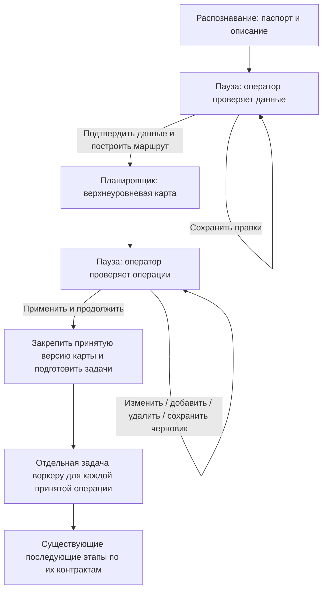

# Проверка оператором перед планированием и перед задачами операций

Дата: 27.10.2026.

**Статус выполнения плана: Частично.** P0–P6 выполнены в зафиксированном техническом объёме; у P7 завершён технический TEST [D269](../03-reports/195-operator-flow-p7-2026-10-27/REPORT.md), человеческая часть остаётся открытой. Новые пункты P8–P15 не выполнены.

| Пункт | Что отслеживаем | Статус выполнения | Основание, дата и что осталось |
| --- | --- | --- | --- |
| P0 | Аудит переходов, входов и исходного TEST | **Выполнено** | 27.10.2026, [D263](../03-reports/189-operator-confirmation-contract-2026-10-27/REPORT.md): матрица UI/API/recovery сохранена; исходный нативный TEST D262 сохранён. В объёме пункта открытых работ нет |
| P1 | Контракт G1/G2, ревизий и повторов | **Выполнено** | 27.10.2026, [D263](../03-reports/189-operator-confirmation-contract-2026-10-27/REPORT.md): типы, SQLite-журнал и негативные проверки выполнены; интеграция проверена последующими P2–P6 |
| P2 | Серверная пауза и явный запуск карты по G1 | **Выполнено** | 27.10.2026, [D264](../03-reports/190-planning-g1-server-2026-10-27/REPORT.md): серверное подтверждение и запрет обходов проверены. Человеческая проверка общего сценария учитывается в P7 |
| P3 | Экран проверки данных и отдельное G1 | **Выполнено** | 27.10.2026, [D265](../03-reports/191-planning-g1-ui-2026-10-27/REPORT.md): сохранение и подтверждение разделены, API/browser-проверки выполнены. Человеческая проверка учитывается в P7 |
| P4 | Редактор карты и отдельное G2 | **Выполнено** | 27.10.2026, [D266](../03-reports/192-route-editor-g2-2026-10-27/REPORT.md): редакции, история и принятие карты проверены технически; человеческая проверка учитывается в P7 |
| P5 | Задачи по операциям принятой карты | **Выполнено** | 27.10.2026, [D267](../03-reports/193-g2-operation-dispatch-2026-10-27/REPORT.md): принятый состав и точные предшественники проверены изолированно. Нативная и производственная приёмки отдельно |
| P6 | Отмена, повторы, ошибки и восстановление | **Выполнено** | 27.10.2026, [D268](../03-reports/194-operation-lifecycle-2026-10-27/REPORT.md): CAS/replay, попытки, поздние ответы и процессные аварии проверены; полная операторская приёмка учитывается в P7 |
| P7 | Сквозная техническая и человеческая проверка | **Частично** | 27.10.2026, [D269](../03-reports/195-operator-flow-p7-2026-10-27/REPORT.md): 3420 backend PASS, финальные 37 PASS, технический TEST завершён. Осталась человеческая проверка; полный нативный проход не выполнен, производственная приёмка отдельно |
| P8 | Модалка проблем и вход из шапки | **Не выполнено** | 27.10.2026: требование записано в 14.1. Осталось реализовать вход, счётчики, список и переход к источнику, проверить с оператором |
| P9 | Ручное уточнение или явный запрос агенту | **Не выполнено** | 27.10.2026: требование записано в 14.2. Осталось реализовать оба пути, выбор проблем и передачу комментария без автоматического вызова |
| P10 | Самостоятельное исследование агентом | **Не выполнено** | 27.10.2026: требование записано в 14.3. Осталось предоставить инструменты доступа к исходнику и проверить самостоятельный поиск/кропы/правки; прежний инспектор не закрывает пункт |
| P11 | Отдельное окно обоснования каждой правки | **Не выполнено** | 27.10.2026: требование записано в 14.4. Осталось реализовать просмотр «было/стало», причины решения и исходного фрагмента |
| P12 | Решения оператора и повторный разбор | **Не выполнено** | 27.10.2026: требование записано в 14.5. Осталось реализовать принятие, ручное изменение, отклонение и уточнение агенту с историей |
| P13 | Отдельное G1 после исправлений | **Не выполнено** | 27.10.2026: требование записано в 14.6. Осталось связать новый путь с серверным G1 и проверить отсутствие запуска карты/цикла при сохранении и принятии правок |
| P14 | История, восстановление и экспорт разбора | **Не выполнено** | 27.10.2026: требование записано в 14.7. Осталось сохранить новые результаты/решения и проверить stale, reload, отмену, повторы и экспорт |
| P15 | Проверки нового сценария | **Не выполнено** | 27.10.2026: требования записаны в 14.8. Остались техническая и человеческая проверки, а также отдельно разрешённая нативная проверка самостоятельного разбора |

Значения статуса: **Выполнено** означает, что заявленный объём пункта реализован и проверен; **Частично** означает выполненную часть при оставшихся работах или проверках; **Не выполнено** означает отсутствие реализации либо свидетельства выполнения. Идея, документ и старый похожий механизм сами по себе не подтверждают выполнение. Подробный состав работ и свидетельства приведены в разделе 4.

Статусы относятся к объёму конкретного пункта. Технический PASS не заменяет человеческую, нативную, SOURCE или производственную приёмку, если они отдельно требуются. При изменении статуса фиксируются дата, основание и оставшиеся ограничения; прежние отчёты не переписываются.

**Дополнение 27.10.2026:** по прямому поручению в этот план добавлены P8–P15: модальное окно проблем распознавания с входом из шапки, самостоятельный разбор агентом по запросу и отдельное обоснование каждой правки. Сейчас поручено только дополнить документ. Реализация, новые модели и возобновление остановленных проверок этим дополнением не разрешены. Подробные требования находятся в разделе 14.

**Основания выполненных этапов.** P0/P1 выполнены в [D263](../03-reports/189-operator-confirmation-contract-2026-10-27/REPORT.md). В [D264](../03-reports/190-planning-g1-server-2026-10-27/REPORT.md) подключён P2: серверная пауза G1, явное подтверждение с durable intent и запрет обходов. 106 адресных и 3378 полных backend-тестов PASS; lint/contracts PASS. P3 подключён в [D265](../03-reports/191-planning-g1-ui-2026-10-27/REPORT.md): 67 API/SQLite, 12 браузерных G1, 8 обзорных и 16 response-сценариев PASS; lint/contracts/build PASS. Редактор и отдельное G2 P4 подключены в [D266](../03-reports/192-route-editor-g2-2026-10-27/REPORT.md): 16 API, 9 editor browser, 12 G1 и 8 overview PASS; полный backend: 3394 PASS. P5 подключён и проверен изолированно в [D267](../03-reports/193-g2-operation-dispatch-2026-10-27/REPORT.md): отдельные задачи принятой G2-карты, 3406 backend PASS, 28 API и финальные 11 P5, 13 editor browser PASS. P6 выполнен изолированно в [D268](../03-reports/194-operation-lifecycle-2026-10-27/REPORT.md): команды отмены/продолжения/повтора, нумерованные попытки, отзыв старого исполнителя и четыре процессные аварии/восстановление; 3418 общих и финальные 98 адресных тестов PASS. Полная приёмка P7 ещё не выполнена. P0–P3 закреплены коммитами 24fd6947/b3d8c192. Исходные два нативных прогона [D262](../03-reports/188-operator-language-planner-2026-10-27/REPORT.md) не повторялись, рабочий стек не перезапускался.

Основание: пользователь 27.10.2026 предложил прекратить ранний автоматический переход от распознавания к техмаршруту, дать оператору проверить данные даже без выявленных противоречий, затем проверить/изменить/добавить/удалить операции и только после применения передать задачи отдельным воркерам. Сначала запрошены план и новый тест с сохранением результатов.

Связанные источники: [границы роли D109](01-ПЛАН_РАЗДЕЛЕНИЯ_МАРШРУТА_2026-10-16.md), [автоматический цикл D001](10-ПЛАН_АВТОМАТИЧЕСКОГО_ЦИКЛА_D001_ДО_СМЕТЫ_2026-10-22.md), [UI/UX D252](14-ПЛАН_UI_UX_ПАСПОРТА_2026-10-26.md), [опыт ручных формулировок D260](../03-reports/187-manual-roughness-language-2026-10-27/REPORT.md). Новое решение меняет предполагаемый автоматический порядок новых запусков; старые свидетельства и выполненные этапы не переписываются.

## 1. Решённый порядок

1. Распознавание заканчивается сохранением паспорта, описания и вопросов. Планировщик не запускается сам, включая случай без конфликтов и предупреждений.
2. Оператор видит источник, данные, вопросы и их влияние. Сохранение исправления создаёт ревизию и оставляет этап на паузе. Отдельное подтверждение закрепляет проверенную ревизию и разрешает построение карты.
3. Планировщик формирует верхнеуровневый маршрут. Подробная проработка операций, время и смета не прячутся внутрь этого первого шага.
4. После публикации карты снова пауза. Оператор может менять текст/условия/порядок, добавлять и удалять операции. Черновое сохранение не запускает воркеров.
5. «Применить и продолжить» сохраняет принятую версию и её изменения, затем запускает подготовку/распределение задач на каждую операцию. Принятый состав не заменяется молча новым маршрутом.
6. Для каждой операции создаётся отдельная задача с её ID, входом/выходом, требованиями, зависимостями и ревизией принятой карты. Это отдельность задач и результатов, а не обязательный новый процесс ОС на каждую операцию.

## 2. Исходное поведение до D264

- `api/routes_parts/recognition.py`: новый полный `/runs/recognition/start` закрепляет `AutomaticLaunch`; `_run_automatic_tail` выполняет допустимые справочные/расчётные шаги и передаёт управление `continue_automatic`.
- `api/routes_parts/automatic_cycle.py::continue_automatic`: D001 создаётся и запускается автоматически при таком launch. `can_run` и conditional отражают доступность входов; согласие оператора они не доказывают.
- Обычная operator revision может ставить автоматический хвост. Уже существует отдельная защита для сохранения внутри D001-family: `launch=None` не разрешает новый D001 model cycle. Это частная защита, а не две требуемые паузы во всём потоке. Legacy-ветвь и явные команды также требуют инвентаризации.
- `d001_coordinator.py` и API циклов имеют start/resume/cancel и сохранённые попытки. Нельзя считать эти команды готовым операторским утверждением карты.
- `route_drafts.py`, `domain/route_drafts.py` и `instructions/d001/ROUTE_PLANNER.md` разделяют карту и проработку операции. На роль остаётся одна стабильная инструкция, без вариантов/skill-композиции.
- D260 доказал сохранение короткого текста и его попадание во вход, но не понимание агентом. «Не могу разобрать» сейчас выглядит непустым описанием; `operator_corrected` обозначает происхождение, а не подтверждение смысла.

## 3. Контракт двух подтверждений

### G1. Проверены данные для построения карты

Подтверждение хранит оператора, время, причину/условия, точный recognition token и паспортную ревизию/отпечаток входа. Это разрешение следующего этапа по этим данным, а не SOURCE или производственная приёмка.

Неразрешённый вопрос остаётся вопросом. Не нужно превращать каждый описательный предел автопроверки в обязательную ручную задачу. Оператор должен видеть, что необходимо для выбранного следующего этапа, что допускается оставить с условиями, а что реально блокирует его по существующему контракту. Нельзя автоматически приравнивать непустой текст или статус ready к проверенному факту. Не строить словарь исключений под отдельные фразы; в P1 определить явное решение «уточнено / не установлено / продолжить с ограничением» с сохранением буквального ввода.

Новая ревизия входов делает прежнее G1 неприменимым к новым данным. Повторное открытие страницы, автосохранение, refresh, NSI/подбор, восстановление процесса и отсутствие предупреждений не создают G1.

### G2. Принята карта для проработки операций

Подтверждение закрепляет карту, версию её операций и основание G1. Для каждой добавленной/изменённой/удалённой операции сохраняются происхождение и история. Стабильные operation_id не зависят от номера строки. Удаление создаёт исторический факт, а не стирает прежние результаты.

Текущий контракт карты линейный. Изменение последовательности должно согласовать входные/выходные состояния и зависимости; новый произвольный граф ради этих кнопок не вводится. Неполный черновик можно сохранять, но нельзя выдавать за пригодное задание воркеру. Числа/владельцы/оборудование не достраиваются по отсутствующим данным.

Если после G2 нужен ещё один вызов планировщика для заданий, он получает принятую карту и операторский diff как вход, сохраняет состав/ID операций и формирует раздачу. Необходимость изменения состава возвращается как предложение на новую проверку G2. Возможность подготовить часть заданий существующим кодом без модели исследуется в P0; семантику не подменять строковыми эвристиками.

Новая правка карты снимает разрешение на новые зависимые задания. Уже полученные результаты остаются в истории; пригодность повторного использования определяется точными входами/зависимостями, а не только совпадением названия операции.

## 4. Последовательность реализации

| Этап | Работа | Выход/проверка | Статус выполнения | Основание и границы |
| --- | --- | --- | --- | --- |
| P0 | Инвентаризировать автоматические переходы нового/legacy контура, кнопки, восстановление, карты и пакеты операций. Сохранить модельный TEST D262 до исправления | Матрица текущих входов/запусков, реальные запросы/ответы и ограничения покрытия | **Выполнено** | Выполнен офлайн в D263: UI/API/recovery и отдельные обходы; нативная исходная точка D262 сохранена |
| P1 | Спроектировать сохранённые G1/G2, токены, события, CAS/idempotency, явные решения по вопросам | Контракт и негативные проверки stale/duplicate; точные названия новых состояний выбираются здесь | **Выполнено** | Выполнен офлайн в D263: типы/SQLite-журнал/негативные проверки; рабочая интеграция на момент D263 была впереди и позднее выполнена в P2–P6 |
| P2 | Остановить автоматический переход после распознавания/правки; связать запуск карты только с явным G1 | Без G1 модель карты и операции не запускаются ни через UI, ни через соседний API/автовосстановление | **Выполнено** | Реализован в D264: 106 адресных и 3378 полных backend-тестов PASS; lint/contracts PASS |
| P3 | Встроить проверку распознавания и кнопку подтверждения в понятный операторский экран | Видны ревизия, неизвестное, блокеры/условия; save и approve различимы | **Выполнено** | Выполнен изолированно в D265: явный G1, точный снимок, stale/retry; 67 API/SQLite и 12 browser-сценариев PASS; рабочий стек не перезапускался. Человеческая проверка включена в P7 |
| P4 | Ввести проверку карты: черновик, правка/добавление/удаление/порядок, применение G2 | Нет потери source_refs/истории; применение ровно один раз закрепляет карту | **Выполнено** | Реализован в D266: immutable draft/CAS/diff, стабильные ID, линейная проверка и атомарное G2/accepted. 16 API и 9 browser PASS; полная регрессия 3394 PASS |
| P5 | Формировать и выдавать задачи принятой карты отдельно по операциям | Каждый воркер видит нужную операцию, принятые изменения, её зависимости и ограничения; неизвестный тип не назначается случайному исполнителю | **Выполнено** | Подключён в D267: атомарный intent с G2, отдельные последовательные задачи из принятого снимка, exact-предшественник, серверные проверки разрешения и статусы UI; 28 API и финальные 11 P5, 13 editor browser PASS. Последующие P6/P7 учитываются отдельными строками |
| P6 | Ошибки, отмена, повтор, редактирование во время работы и restart | Нет скрытого перехода через паузу, повторного списания/выдачи и публикации результата старого входа в новую карту | **Выполнено** | Выполнен изолированно в D268: CAS/replay команды, нумерованные попытки, версии выдачи, отмена/правка и сохранность поздних ответов, явное восстановление exact-префикса и retry с UNKNOWN. 3418 общих и финальные 98 адресных тестов, 19 editor browser PASS; P7 учитывается отдельно |
| P7 | Полный операторский TEST последовательности и регрессия истории/экспортов | Сначала техническая, затем человеческая проверка; результаты отдельно от производственной приёмки | **Частично** | Технический сквозной TEST выполнен в D269: настоящие SPA/API/SQLite с TEST-ответами, G1/G2/reload, ручная редакция, три операции, история и экспорт. Человеческая часть открыта; нативная и производственная приёмки отдельно |
| P8 | Вынести проблемы распознавания в отдельную модалку с заметным входом из шапки | Оператор открывает краткий список проблем и правок агента, не ищет их в длинном описании | **Не выполнено** | Новое требование 27.10.2026; см. 14.1 |
| P9 | Дать выбор ручного уточнения или явной отправки выбранных проблем агенту | Одну проблему или связанную группу можно исправить самому либо передать агенту с комментарием; открытие модалки модель не вызывает | **Не выполнено** | Новое требование 27.10.2026; см. 14.2 |
| P10 | Дать агенту самостоятельное исследование исходника и подготовку правок | Агент сам находит нужный контекст, создаёт кропы и сопоставляет виды без заранее подготовленного человеком набора фрагментов | **Не выполнено** | Существующий адресный инспектор не подтверждает выполнение этого нового сценария; см. 14.3 |
| P11 | Показывать каждое исправление в отдельном окне с обоснованием | Для каждой правки доступны исходное значение, предложение, конкретная причина и проверяемый фрагмент источника | **Не выполнено** | Новое требование 27.10.2026; см. 14.4 |
| P12 | Подключить принятие, редактирование, отклонение и повторный разбор правок | Оператор принимает выбранные/все правки либо исправляет/отклоняет их; может уточнить задачу агенту по конкретной проблеме | **Не выполнено** | Решение агента и решение оператора сохраняются отдельно; см. 14.5 |
| P13 | Сохранить обязательное операторское G1 после ручного или агентского исправления | Работа агента, сохранение и принятие правок не запускают карту/цикл; отдельное G1 относится к проверенной текущей ревизии | **Не выполнено** | G1 уже реализовано для прежнего потока; интеграция нового пути с ним ещё не проверена; см. 14.6 |
| P14 | Сохранить ревизии, историю, восстановление и экспорт нового разбора | Не теряются исходные данные, объяснения, кропы, предложения и решения; reload/retry не создают скрытый повтор или применение устаревшей правки | **Не выполнено** | Новые сущности и их связь с существующими контрактами ещё не реализованы; см. 14.7 |
| P15 | Проверить новый сценарий технически и затем с оператором | Проверены самостоятельный поиск контекста, достоверность обоснований, модалка, ручной путь и отсутствие запуска до G1 | **Не выполнено** | Нужны отдельные свидетельства технической, человеческой и явно разрешённой нативной проверок; см. 14.8 |

P2 не реализовывать как один UI-флаг: проверка должна действовать на сервере. Размещение детерминированного NSI/геометрического preview до G1 уточняется в P0; их наличие не разрешает модельный маршрут или воркеров. После P5 порядок времени/сметы остаётся предметом действующих контрактов; дополнительных пауз, которых пользователь не просил, этот план не назначает.

## 5. Обязательные сценарии приёмки

- Полное, частичное, конфликтное и внешне бесконфликтное распознавание всегда заканчивается первой паузой. До G1 ноль новых вызовов карты/операций.
- Чтение/refresh страницы и save правки ничего не подтверждают и не запускают модель. Уточнение «не могу разобрать» не становится установленной поверхностью.
- G1 закрепляет ровно видимую ревизию. Двойной клик, повтор HTTP и restart не создают второй запуск; stale-команда возвращает явный конфликт.
- Готовая карта заканчивается второй паузой; до G2 ноль выдач воркерам.
- Правка, добавление, удаление и перестановка сохраняются в черновике и истории. После G2 воркер получает именно принятую карту, а не первоначальный ответ модели.
- Удалённая операция не выдаётся; новая получает устойчивый ID; неизменные/изменённые зависимости различимы. Воркеры не перезаписывают соседние операции.
- Частичный/ошибочный ответ, отмена и устаревание сохраняют черновик и сырой результат. Нет ложного «применено» или автоматического перехода через паузу.
- Старые рабочие истории и циклы читаются; изменение порядка новых запусков не переписывает результаты задним числом. Импорт/export различают подтверждённые ревизии и черновики.

## 6. TEST перед исправлением

Отдельно разрешённый текущим запросом сравнительный опыт: два входа D260 «крайняя левая шейка» / «где-то слева», существующая роль route_planner, текущий профиль, одинаковый источник. Повторного распознавания и воркеров/времени/сметы нет. Партия 1 — явно тестовая настройка, не восстановленный факт чертежа. Допустимо добавить одинаковый сохранённый растр: D260 проверял только передачу текста и не включил изображения в свои planning_input. Все отличия входов и их SHA фиксируются до вызова.

Бюджет: две логические задачи карты; штатный максимум две форматные попытки на задачу (до четырёх внешних вызовов), без дополнительных семантических повторов. Текущий профиль/инструкция фиксируются, модель не подменяется. Сохраняются родные ответы, запросы, usage, ошибки, публикация и анализ. Различия общего маршрута не объявляются причинным эффектом одной фразы по одной паре стохастических запусков. Если обработка не удалась, отказ также становится исходным результатом, а не замалчивается или автоматически перезапускается.

Тестовый harness не реализует новый производственный порядок. Он намеренно не выдаёт задачи воркерам, чтобы сохранить измеряемую границу первого планировщика. Рабочее приложение/БД не перезапускаются и не записываются. Изолированные БД после подтверждённого завершения архивируются общим scripts.stack_storage с сохранением квитанций; уникальные артефакты и исходные байты сохраняются. Результат теста нужен для последующего исправления и проверок, но не закрывает P1–P7, UI-приёмку D252, SOURCE или производство.

## 7. Зафиксированная исходная точка D262

Два нативных прогона текущего route_planner завершены без изменения продукта: точная фраза перенесена как цель требования, «где-то слева» осталось target=null с явной причиной. Первый ответ остановился на границе сварки (needs_scope_review, 0 операций), второй предложил 6 условных операций при сохранённом вопросе сварки. Это наблюдение одной стохастической пары, не доказательство причинности общего различия маршрутов.

Полные запросы, raw/publication, usage, текущие производственные источники и ограничения опыта — в [D262](../03-reports/188-operator-language-planner-2026-10-27/REPORT.md). Для P0/P1 учесть различение ready/proposed и человеческого согласия, решение о границе сценария отдельно от изменения буквального ТТ, перенос нераспределённых требований и неподдерживаемые направления grinding/marking/quality_control. Публикация отдельно удержала одно неподтверждённое числовое значение; этот защитный отказ нельзя обходить ради видимости завершения.

Тест не выдавал задачи воркерам и не проверял будущие G1/G2. В исходном пакете не выбрана заготовка; существующая остановка stock-required учтена в инвентаризации D263. Точный текст плана до модельных вызовов сохранён в D262/PLAN_BEFORE_TEST.md. Последующие P0/P1 и подключение P2 в D264 не меняют исторические ответы D262. На конец D264 P3–P7 оставались открыты; P3 позднее выполнен в D265.

## 7. Начало реализации: D263, P0/P1

По поручению начать этот план выполнены [матрица всех входов](../03-reports/189-operator-confirmation-contract-2026-10-27/INVENTORY.md) и [контракт подтверждений](../03-reports/189-operator-confirmation-contract-2026-10-27/CONTRACT.md). Помимо основного хвоста найдены прямые legacy-переходы из NSI/estimate, отдельные map/blank API и старый pipeline без сохранённого токена. Допуски/preview могут оставаться детерминированными до G1, автоматический material research содержит модельный вызов и не должен скрываться внутри этой паузы.

Журнал различает save_review и confirm, фиксирует точный recognition/passport/planning basis, G2 с текущим G1 и ревизией карты, literal ввод/условия, actor/время, CAS, replay и историю. Состояния проверки: awaiting_review, blocked, confirmed, stale. Повторная квитанция не является новой выдачей. Существующий assemble/build_packet способен упаковывать отдельные задачи без дополнительного планировщика, если принятая карта и зависимости пригодны; selected_blank/предшественники/поддерживаемая роль всё ещё требуются.

На конец D263 компонент ещё не импортировался рабочими router/coordinator/startup. Его последующее подключение P2 описано ниже. Нативная/человеческая проверка и отдельные производственные ограничения остаются открыты.

## 8. D264: P2 подключён серверно

Автоматические d001/legacy/None-переходы теперь объявляют первую паузу. Подготовка данных и save_review не запускают карту; confirm сохраняет G1 и pending intent в одной транзакции, перед выдачей и публикацией проверяются точные входы/голова/отмена. Exact replay возвращает историческую квитанцию без повторного resolver или фонового задания; текущая применимость при replay не объявляется подтверждённой.

Поддерживаемый новый путь описан в [контракте API D264](../03-reports/190-planning-g1-server-2026-10-27/REPORT.md): map-review/input → явное confirm → карта. Старые route/map/cycle/start/resume, standalone pipeline и deep-analysis не становятся обходами. G1 выдаёт только карту; редактор G2 и проработка операций ещё P4/P5. Существующие история/cancel/чтение и неизменяемые ответы сохранены.

На конец D264 экран P3 ещё не подключался; последующее выполнение описано в D265 ниже. Полный операторский и нативный TEST не проводился; это не приёмка SOURCE, времени, сметы или изготовления. Рабочие данные/сервер не запускались этой проверкой; изменения не закоммичены и не опубликованы.

## 9. D265: P3 подключён в интерфейсе

Обзор и загрузка чертежа объясняют паузу после чтения. Во вкладке «Техмаршрут» подготовка проверки показывает закреплённые входы, ревизию, вопросы/блокеры и условия. «Сохранить проверку без запуска» и «Подтвердить данные и построить карту» — отдельные команды. Даже отсутствие вопросов не даёт автоматического подтверждения. Правка паспорта/выбора не запускает планировщик и требует актуальной проверки.

После потери ответа/reload сохраняется точная команда с прежними ID/actor; повтор возвращает квитанцию без второй выдачи. Текущая применимость читается отдельно. Старые map/legacy/cycle старты убраны из операторского входа; история, отмена и ручные сохранения доступны. G1 запускает только карту, P4–P7 остаются открыты.

[Отчёт и свидетельства D265](../03-reports/191-planning-g1-ui-2026-10-27/REPORT.md): 67 API/SQLite-тестов, 12 G1 browser-сценариев, 8 обзорных и 16 проверок ответов PASS; lint/contracts/build PASS. Браузерные ответы TEST синтетические, API-проверки используют настоящий router/SQLite с TEST-провайдером. Человеческая/производственная и полная нативная приёмка не проводилась; рабочих записей/перезапуска, моделей и commit/push нет.

## 10. D266: P4 — редактор и принятая версия

По прямому поручению пользователя P0–P3 закреплены двумя коммитами, затем подключён редактор состава карты. Можно менять, добавлять, удалять и переставлять операции и состояния. ID и исходные ссылки сохраняются; связи не перепривязываются догадкой. Неполный черновик сохраняется отдельно от строгой карты для выдачи.

Применение G2 закрепляет последнюю сохранённую ревизию и её diff вместе с событием подтверждения в одной SQLite-транзакции. Повтор возвращает прежнюю квитанцию; новая правка, устаревшее G1/исходная карта или отмена снимают применимость для новых зависимых задач. История и исходный ответ модели не переписываются. Save не выдаёт заданий.

[Отчёт D266](../03-reports/192-route-editor-g2-2026-10-27/REPORT.md): 16 API/SQLite, 9 editor browser, 12 G1 и 8 overview PASS; lint/contracts/build PASS. Полная backend-регрессия: 3394 PASS. P5 выдачи отдельных задач, P6 и P7 остаются открыты. Продуктовых моделей/рабочего перезапуска/push нет.

## 11. D267: P5, выдача принятой карты

G2 атомарно закрепляет принятую карту и неизменяемое намерение выдачи с порядком operation_id и профилями исполнителей. После commit выдаются отдельные последовательные задачи: только принятые ручные изменения и точный опубликованный результат предшественника с его ограничениями. Карта повторно не строится. Save не выдаёт задач; новое сохранение снимает применимость прежнего G2. Неподдерживаемое направление, `needs_route_review` или ошибочная публикация останавливают зависимый хвост.

Проверка актуального G2 действует на сервере при закреплении/создании задания, перед моделью и внутри транзакции публикации. Ответ уже начавшейся модели после правки сохраняется в истории, но не становится текущим и не открывает следующую операцию. Повтор/reload не повторяет модель. Pending можно пробудить явно по тому же актуальному G2; claimed после restart становится interrupted без автоматического повтора.

[D267: реализация, проверки и ограничения](../03-reports/193-g2-operation-dispatch-2026-10-27/REPORT.md). UI различает принятие, очередь/выполнение/остановку и отдельные результаты. Старые raw/worker API не открыты; историческим G2 не добавляются синтетические очереди. Выбранная круглая заготовка остаётся обязательной для пакета операции; отсутствие `selected_blank` даёт явную остановку, а не угаданную заготовку. Полная стратегия повторов/возобновления/переиспользования, P6/P7, человеческая и производственная приёмки остаются открыты. Рабочего запуска/перезапуска, продуктовых моделей, commit/push нет.

## 12. D268: P6, ошибки и восстановление

P5 вместе со свидетельствами сохранён локальным коммитом `82bb1301`. Затем подключены отдельные CAS-команды отмены, продолжения очереди и повтора незавершённой операции. Точные повторы возвращают immutable квитанции без resolver и второй выдачи. Журнал попыток/отметок перед провайдером и generation выдачи не позволяют старому исполнителю публиковать после отмены, новой команды, правки или restart. Поздние ответы остаются у исходной попытки.

Продолжение перепроверяет входы и текущую публикацию завершённого префикса; они не вызываются повторно. После уже возможного обращения к провайдеру неизвестный исход/расход остаётся UNKNOWN и требует отдельного retry. Новая редакция карты останавливает прежнюю выдачу в одной транзакции с save, не разрешая новых задач. Отмена дочернего run проверяется и для G1-карты, и для операций. Неподходящий префикс или `needs_route_review` требует новой проверки карты.

[Отчёт D268 и границы проверок](../03-reports/194-operation-lifecycle-2026-10-27/REPORT.md): общий прогон 3418 PASS, после заключительных уточнений финальные 98 адресных PASS; четыре реальные процессные аварии/восстановление, 19 editor browser, 12 G1 и 16 response-сценариев PASS. Lint/contracts/build PASS. Инструкции и прежние свидетельства сохранены; нативных моделей, рабочего запуска/перезапуска и push нет. P6 включён в текущую фиксацию; P7, человеческая/полная нативная и производственная приёмки открыты.

## 13. D269: технический сквозной TEST P7

По прямому поручению продолжить P7 завершён проход собранной SPA через production API и изолированные SQLite: сохранённое TEST-чтение, save/reload без моделей, отдельное G1, ручная правка/удаление/перестановка/добавление операций, отдельное G2 и три последовательные проработки с точными предшественниками. Потеря HTTP-ответов G1 и G2 с reload и повтором команды не добавляет вызовов. После новой правки прежняя принятая версия остаётся в истории, но её G2 к новому черновику не применяется.

Исправлен review-pack: исходные G1/G2, черновики, принятые редакции и журнал выдачи экспортируются отдельно. Старым запускам не добавляются подтверждения или таблицы. Офлайн-пакет не выдаёт разрешений и явно не оценивает текущую применимость. История, правки паспорта и старые экспорты сметы проверены регрессией; подробные результаты, снимки и ограничения в [D269](../03-reports/195-operator-flow-p7-2026-10-27/REPORT.md).

Техническая часть P7 выполнена, человеческая проверка удобства обеих пауз/редактора остаётся открытой. Нативные продуктовые модели не вызывались, реальный чертёж не распознавался; SSE в интеграционном стенде проверялся только через штатный polling fallback. Это не полная нативная, SOURCE, времени/сметы нового G2 или производственная приёмка. Рабочего запуска/перезапуска, commit/push нет.

## 14. Дополнение: проблемы распознавания и самостоятельный разбор агентом по запросу

Дата: 27.10.2026. Основание: обсуждение с пользователем и прямое поручение добавить согласованный сценарий новыми пунктами в этот документ. **Статус P8–P15: Не выполнено.** В этом дополнении фиксируются требования к будущему сценарию; реализация и проверки продукта не начинаются.

### 14.1. P8: вход из шапки и модальное окно проблем

После распознавания проблемные места продолжают подсвечиваться. На верхнем уровне шапки рабочего пространства нужен заметный элемент «Проверка распознавания» со счётчиком открытых вопросов и отдельным указанием новых правок агента. Пример формулировки: «7 вопросов · 3 правки для проверки». Точное оформление проверяется при реализации с оператором.

Нажатие открывает отдельную модалку. В ней находятся краткие карточки проблем, их состояние, влияние на продолжение и доступные действия. Полный инженерный текст не требуется читать для обнаружения вопросов; пояснения к конкретной проблеме раскрываются адресно. Из карточки можно перейти к соответствующей записи и исходному чертежу. Контекст выбранной проблемы сохраняется при просмотре источника и возврате в список.

Вопрос и предлагаемое исправление различимы. Появление текста, завершение агентского разбора или предложение правки сами по себе не означают, что вопрос разрешён. В частности, «не могу разобрать» сохраняется как сообщение о неопределённости. Подробности и прежние свидетельства остаются доступны, даже когда вопрос больше не входит в список открытых.

### 14.2. P9: ручное уточнение или явная отправка агенту

Оператор выбирает для конкретной проблемы: «Уточнить самому» либо «Разобрать агентом». Он также может выбрать несколько связанных проблем и отправить их вместе. Свободный комментарий оператора передаётся дословно и сохраняется с задачей. Ручной путь остаётся доступен без обращения к агенту.

Вызов агента происходит только по отдельному явному запросу. Загрузка распознавания, подсветка проблем, открытие/закрытие модалки, refresh и сохранение ручного текста не дают такого разрешения. Не нужно вручную обрабатывать все вопросы до обращения к агенту. При повреждённом состоянии данных показывается причина невозможности разбора; структурная ошибка не превращается в массовую визуальную очередь.

### 14.3. P10: агент самостоятельно исследует проблему и готовит исправления

Агенту предоставляются доступ к неизменяемому оригиналу чертежа, текущему сохранённому распознаванию, проблемам и комментариям оператора, а также инструменты просмотра и работы с источником. Программа автоматически фиксирует исходную ревизию и происхождение данных. Человек или отдельный предварительный исполнитель не должен заранее искать нужную поверхность, готовить кропы, собирать доказательства или составлять за агента разбор.

Агент сам определяет последовательность исследования: находит участок на листе, смотрит общий контекст и связанные виды, создаёт/расширяет кропы, меняет масштаб, поворачивает копии для чтения, использует доступный исходный PDF-слой, если он действительно присутствует, и сопоставляет увиденное с сохранёнными записями. Отсутствие заранее установленной области не исключает начало самостоятельного поиска. Оригинал и его координаты сохраняются; координаты кропа не подменяют координаты листа.

Результат разбора может подтвердить исходную запись, подготовить исправление или оставить конкретную неопределённость с объяснением. Если один участок неразборчив, агент может продолжить работу с остальными выбранными проблемами. Владелец, значение и графическая связь должны иметь собственное основание в источнике; похожее число, соседство или одна уверенность агента таким основанием не являются. Смысловой разбор выполняет агент, код проверяет структуру, ссылки и применимость правок. Новые частные правила под каждый чертёж не являются предполагаемым способом решения.

Существующий адресный инспектор и фильтрация [D069](../03-reports/05-inspector-queue-repair-2026-10-16/REPORT.md) учитываются при реализации. Они не подтверждают готовность нового самостоятельного сценария. Сохраняется отделение инфраструктурных причин от визуальных вопросов; все предупреждения подряд автоматически агенту не выдаются. Не вводятся произвольные квоты на число кропов или шагов, принуждающие к незавершённому выводу; расход учитывается, отмена оператором доступна.

### 14.4. P11: отдельное окно с обоснованием каждого исправления

У каждого исправления открывается отдельное окно подробного просмотра. В нём обязательны: исходное состояние «было», предложение «стало», предметное объяснение принятого решения, использованный фрагмент источника и возможность посмотреть его окружение/связанный вид. Для связанной группы правок видны общий разбор и основание каждой отдельной правки. Формулировки «агент уверен» недостаточно.

Если агент подтвердил прежнюю запись или не смог разрешить вопрос, его вывод также доступен с обоснованием: что проверено и почему исправления нет либо каких данных не хватает. Предложение агента, проверка структуры программой и решение оператора показываются как разные действия. Технические идентификаторы и подробный журнал доступны дополнительно, без необходимости понимать их для принятия решения.

### 14.5. P12: просмотр, принятие и уточнение правок оператором

Агент самостоятельно подготавливает исправления в сохраняемой предлагаемой ревизии; его завершение не делает их одобренными оператором. Оператор может принять правку, изменить её сам или отклонить; для группы доступны принятие выбранных либо всех просмотренных правок с сохранением основания каждой. До принятия исходные данные и новая предлагаемая версия различимы.

В окне конкретной проблемы оператор может дописать уточнение, например «посмотри вид А», и явно отправить её на повторный разбор. Сохраняются предыдущий вывод, новый комментарий и последующее решение. Уже подтверждённые ручные исправления не перезаписываются молча. Неразрешённые вопросы остаются в списке с конкретной причиной; при допустимом продолжении с ограничением сохраняется явное решение оператора.

### 14.6. P13: принятие исправлений не запускает маршрут или цикл

После завершения агентского разбора интерфейс показывает наличие результатов для проверки и остаётся на первой паузе. «Принять исправления» сохраняет принятые изменения и обновляет вопросы. «Подтвердить данные и построить карту» остаётся отдельным действием G1 по точной текущей ревизии. До проверки и явного G1 оператора карта, задачи операций и цикл автоматически не запускаются.

Это правило действует для ручного уточнения, агентских предложений, принятия группы правок и повторного разбора. Оно проверяется сервером, включая старые API/автоматические переходы. Изменённая ревизия не наследует применимость прежнего G1; запоздалый ответ агента по старой ревизии не применяется автоматически к новой. G2 и последующие роли сохраняют существующие отдельные границы.

### 14.7. P14: история, восстановление и экспорт

Сохраняются исходная ревизия и проблема, буквальный комментарий оператора, использованные исходные фрагменты, ход доступных проверке действий, предложение, обоснование каждой правки, её принятие/изменение/отклонение и полученная ревизия. История и экспорт различают исходные факты, предложения агента и принятые оператором изменения.

Reload, потерянный ответ, отмена и восстановление процесса не создают скрытого нового вызова или повторного применения. Сохранённые результаты доступны для проверки после повторного открытия модалки. Неизвестный исход/расход и явный новый вызов различимы; устаревшие результаты остаются историей. Новые данные включаются в офлайн-пакет с доказательствами, сохраняя границу исторического решения и текущей применимости, установленную D269.

### 14.8. P15: проверки и условия завершения новых пунктов

Технические проверки должны покрыть вход из шапки, краткий список и отдельное окно правки; ручное исправление без модели; явный вызов для одной проблемы/группы; самостоятельный поиск нужного контекста; проверяемое обоснование; подтверждение исходной записи и честную неразрешимость; принятие/отклонение/уточнение; stale/reload/отмену/историю/экспорт; отсутствие карты и цикла до отдельного G1. Непустой текст и завершённая работа агента не должны скрывать остающийся вопрос.

Для свидетельства самостоятельного исследования агент не получает заранее подготовленный правильный кроп, ожидаемый ответ или готовое обоснование. Его обращения к источнику и итог сопоставляются с исходником. Проверка сохранения/передачи с TEST-ответами не выдаётся за проверку реального смыслового разбора. После технических проверок оператор отдельно оценивает понятность модалки, обоснований и действий.

Нативная проверка требует отдельного явного разрешения и согласованного показательного набора реальных проблем с учётом действующих ограничений инспектора. Документирование P8–P15 не возобновляет остановленные проверки. Пункты переводятся в «Выполнено» по их собственным свидетельствам; открытая часть отражается статусом «Частично». Общая производственная приёмка этим сценарием не закрывается.
